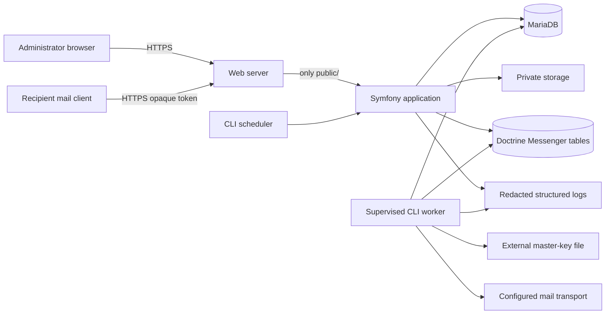

# Architecture

**Status:** Phase 4 identity, administration, sessions, and audit plus locked product design.

**Last reviewed:** 2026-08-15

## System context

Emailer Next is one self-hosted installation for one organisation on one
server. Several individually authenticated administrators may use it, but there
is no tenant selector, tenant identifier, shared control plane, or
cross-organisation data path.

The application is a Symfony 7.4 LTS modular monolith running on PHP 8.4 or a
newer supported branch. MariaDB is the transactional source of truth. Twig,
AssetMapper, and small Stimulus controllers provide the server-rendered
administrative UI. A supervised CLI worker performs delivery through Symfony
Messenger; an HTTP request can enqueue approved durable work but can never run
the delivery worker.

## Implemented through Phase 4

The repository implements the platform shell and secure setup boundary:

- a final Symfony kernel with externally supplied runtime configuration;
- Doctrine DBAL/ORM and Migrations configured for MariaDB, including the
  bounded Phase 3 setup/configuration/Owner/secret schema;
- Mailer, Doctrine Messenger transports, Security, Twig, AssetMapper/Stimulus,
  Validator, RateLimiter, Lock, and Monolog framework wiring;
- central structured JSON log processing with conservative redaction;
- the `Health` module's coarse liveness controller;
- Docker Compose application, MariaDB, and Mailpit services;
- CI, static architecture enforcement, isolated mail tests, and an allowlisted
  production-shaped artifact.

Phase 2 added the `Setup` module: fail-closed setup-mode routing, a 160-bit
filesystem ownership challenge, private hashed setup state, safe fixed-path
proof verification, post-proof HTTPS gating, system preflight, installation
lock/reset abstractions, and the bounded CLI alternative. Identity, credential
collection, content, campaign, and delivery remained unimplemented.

Phase 3 completes the setup-only path with MariaDB schema migration, an
external restrictive master-key file, HKDF/XChaCha20-Poly1305 secret records,
singleton organisation and sender configuration, an Argon2id initial Owner,
optional encrypted TOTP plus hashed recovery codes, bounded delivery/privacy
defaults, exact plaintext/unauthenticated Mailpit-only transport evidence,
critical setup preflight, and compensating installation-lock finalization. All
Phase 3 writers and finalization share one cross-process lifecycle lock. The
fixed installation-completion event remains separate from general audit.

Phase 4 adds individual administrative accounts, the four-role hierarchy,
deny-by-default route and service authorization, password/TOTP authentication,
purpose-bound re-authentication, database sessions, password recovery through
Mailpit, a server-rendered administration shell, and append-only redacted audit
events. Session identifiers and source metadata are stored only as
purpose-separated HMACs. Sessions have 30-minute idle and 12-hour absolute
limits and rotate when authentication authority changes. A central registry
defines every `admin_` route's methods and minimum role; an unregistered route
fails closed. Identity services repeat authorization and serialize final-Owner
mutations with row locks. Content, campaigns, delivery workers, production
sending, backup/restore, release, and deployment remain unimplemented.

### Setup state transition

An absent private installation lock keeps ordinary application routes at a
generic setup-required response. `GET /setup` issues a rate-limited challenge;
`POST /setup/proof/verify` verifies only `.emailer-install-proof`, deletes proof
and private state on success, and rotates the session. Preflight then requires
the verified session and HTTPS. A present lock makes every setup route return
404. Phase 3 publishes the lock only after all setup rows, explicit external-key
validation, exact Mailpit evidence, safe defaults, and CLI capability checks
pass. Every writer rechecks both database completion and filesystem lock while
holding the same lifecycle lock used by finalization.
Database completion precedes lock publication; publication failure is
compensated, while an interruption before publication remains resumable and
never appears installed.



## Architectural invariants

1. Only `public/` is a web document root. Source, Git metadata, configuration,
   private files, logs, backups, dependencies, and the master key are never
   web-served.
2. Setup is fail-closed. Until an installation lock exists, ordinary
   administration and all delivery are unavailable.
3. MariaDB owns durable business state. Browser sessions and in-process memory
   never define campaign progress.
4. Dynamic secrets are authenticated-encrypted in the database. The 32-byte
   master key is stored in a restrictive external file and never in the
   database, queue, logs, session, or Git.
5. Delivery is at-least-once processing with best-effort duplicate
   minimisation. The product never claims exactly-once SMTP delivery.
6. Every production message is constructed for one recipient. There is no
   bulk-BCC path.
7. Every send path checks the global suppression store immediately before the
   transport attempt.
8. Browser mutations require authentication where applicable, authorization,
   an unsafe HTTP method, and CSRF protection. Public recipient mutations use
   a purpose-scoped opaque token instead of an admin session.
9. Tests and default development configuration can use fake SMTP only.
10. Domain and application rules do not live in controllers, templates,
    Doctrine entities, console commands, or JavaScript.

## Internal structure

Each required module is placed below `src/Module/<ModuleName>/` and is split
into four inward-facing layers:

```text
Presentation -> Application -> Domain
Infrastructure -> Application/Domain contracts
```

- **Domain** contains business rules and value objects without framework or
  persistence dependencies.
- **Application** coordinates use cases, transactions, authorization checks,
  and ports.
- **Infrastructure** implements persistence, mail, filesystem, crypto, clock,
  and framework adapters.
- **Presentation** maps HTTP/CLI input to application commands and maps results
  to safe responses.

Cross-module calls use explicit application contracts, immutable identifiers,
or redacted domain events. Modules do not query another module's tables, reuse
its Doctrine entities, or bypass its authorization and invariants. Detailed
ownership and allowed dependencies are in
[module-boundaries.md](module-boundaries.md).

## Runtime flows

### Administrative request

The web server terminates or forwards verified TLS, serves only `public/`, and
passes the request to Symfony. Security resolves the individual account and
session. Route authorization and, for mutations, CSRF and recent
re-authentication are checked before an application service starts a database
transaction. Responses use security headers, suppress sensitive caching, and
show a correlation identifier rather than internal detail on failure.

### Campaign queueing

Approval snapshots the chosen template and audience into durable records.
Queueing creates unique campaign-recipient ledger rows transactionally before
dispatching identifiers-only messages to the Doctrine transport. Serialized
messages contain no address, rendered body, credential, token, or secret.

### Delivery

A CLI-only worker claims a ledger item, checks campaign state and suppression,
loads the encrypted transport configuration, decrypts it only at the adapter
boundary, builds one message, applies global and per-domain limits, and attempts
delivery. It records accepted, retryable, permanent, suppressed, cancelled, or
ambiguous state. A crash is recovered from durable state; an ambiguous SMTP
outcome is exposed to an operator rather than guessed.

### Public recipient action

A public route accepts an opaque, purpose-scoped token. Verification checks
authenticity, purpose, scope, key version, and expiry without an admin session
or raw recipient data in the URL. Mutations are idempotent. Public endpoints do
not start an admin session and emit only redacted telemetry.

## Storage boundaries

- **MariaDB:** durable application, session, queue, audit, health, and ledger
  state.
- **Private directory:** temporary imports, rejection reports, exports,
  backups, setup state, and other non-public files. It is outside `public/`.
- **Public asset directory:** only reviewed static application assets and
  sanitized, non-executable uploaded raster images.
- **Secret-key file:** explicitly configured absolute external 32-byte master
  key, mode `0600`, parent mode `0700`; production rejects application/release/
  public placement, unsafe ancestor ownership/modes, links, and ancestor/path
  replacement.
- **Logs:** structured UTC records with strict redaction and bounded retention.

The initial relational design is in [data-model.md](data-model.md). Paths in
documentation are examples only and never authorize placing a real secret in
the repository.

## Deployment profiles

The preferred profile is PHP-FPM behind Nginx or Apache, MariaDB, a
long-running Messenger worker under systemd or Supervisor, and a CLI scheduler.
A restricted-hosting profile may run a bounded, locked worker from cron. The
Doctor must identify the selected profile, verify heartbeats, and block new
production sends when its required execution mechanism is unavailable.

Releases are immutable artifacts built from committed source and the lockfile.
Writable state is external to the release. Phase 1 tests the artifact boundary
but does not create a release. Deployment, release, and rollback remain explicit
operator actions and are not implemented.

## Decision records

The design is governed by accepted ADRs `0001` through `0010` in
[docs/adr](adr/). A change to an invariant requires a superseding ADR, updated
threat model, route/data review where relevant, and passing quality gates.
