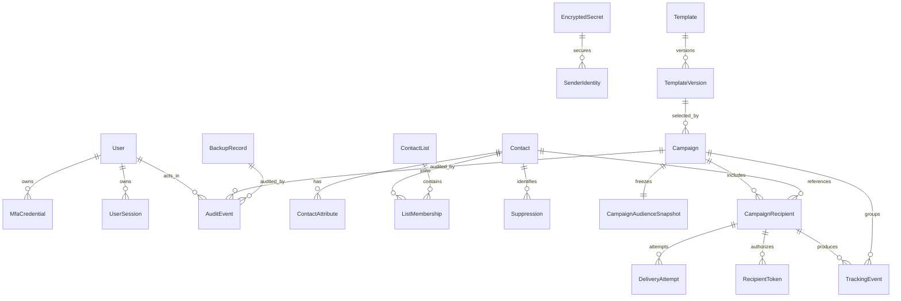

# Initial data model

**Status:** Phase 8 operations evidence schema over the Phase 7 delivery and recipient-safety model.

`DoctrineMigrations\Version20260723000000` remains the no-schema platform
smoke check. Phase 3 adds `Version20260815000000`, which creates only the
secure first-run tables below, and `Version20260816000000`, which constrains
the setup mail row to the exact local Mailpit probe. Phase 4 adds identity and
audit; Phase 5 adds contact/import/suppression/template storage; Phases 6–7 add
campaign/delivery and recipient-token state; Phase 8 adds operational evidence.

## Implemented through Phase 5

| Table | Owner | Enforced purpose |
| --- | --- | --- |
| `installation_state` | Setup | Singleton installation UUID and non-secret step/completion timestamps |
| `organisation_settings` | Configuration | Singleton name, canonical HTTPS origin, locale, and time zone |
| `encrypted_secret` | Secrets | UUIDv7 identity, versioned authenticated envelope, and rotation metadata |
| `app_user` | Identity | Initial active `ROLE_OWNER`, normalized unique login, and Argon2id hash |
| `mfa_credential` | Identity | Encrypted TOTP-secret reference with last accepted counter, or hashed single-use recovery code |
| `sender_identity` | Configuration | Exact plaintext/unauthenticated local Mailpit metadata and sender identity; no credential or TLS-verification claim |
| `delivery_policy` | Configuration | Bounded delivery/import limits and detected CLI execution mode |
| `privacy_policy` | Configuration | Tracking/RSVP off, global suppression mode, and bounded retention/footer defaults |
| `setup_installation_event` | Setup | Exactly one append-only `installation.completed` event; not the Phase 4 audit system |
| `user_session` | Identity | HMAC-identified server session payload, nullable account binding, idle/absolute deadlines, permanent revocation tombstone and hashed source metadata |
| `login_throttle` | Identity | Purpose-HMAC login and re-authentication counters, progressive delay and bounded lockout timestamps |
| `password_reset_token` | Identity | UUIDv7 selector, SHA-256 token hash, short expiry and consumption timestamp |
| `audit_event` | Audit | Append-only actor/action/opaque target/result/redacted summary; database triggers reject update and delete |
| `contact` | Contacts | Entered and conservative comparison address, bounded profile/consent fields, active/archive lifecycle |
| `contact_field_definition` / `contact_attribute` | Contacts | Administrator-defined bounded schema and one validated value per contact/key |
| `contact_list` / `list_membership` | Contacts | Archiveable named lists and idempotent unique contact/list membership |
| `suppression` | Suppression | Durable add-only Phase 5 global address suppression with unique comparison value |
| `contact_import` / `contact_import_candidate` | Contacts | Private upload integrity metadata, bounded preview counters/report token, and database-staged unique candidates |
| `email_template` / `template_version` | Templates | Template lifecycle and immutable sanitized versions with merge/link manifests and content digests |
| `template_asset` | Templates | Metadata for content-detected, dimension-bounded, re-encoded raster files |
| `health_check_run` | Health | Redacted immutable Doctor result, counts, stable findings, and timestamps |
| `backup_record` | Backup | Encrypted artifact identity/digest/size, source/schema versions, and verification time; no path or key |
| `release_operation` | Release | Redacted inspect/install/update/rollback version, digest, state, and result code |
| `housekeeping_run` | Housekeeping | Dry-run/apply flag, bounded per-category counts, result, and timestamps |

`Version20260817000000` expands `app_user` to all four administrative roles and
adds change/login/disable timestamps while reusing the Phase 3 account and MFA
tables. It is forward-only because deleting identity and audit history is not a
safe automated rollback.

`Version20260818000000` preserves session tombstones when users are deleted,
adds the last accepted TOTP counter, and admits dedicated re-authentication
throttle scopes. It is also forward-only.

`Version20260819000000` adds the Phase 5 tables above. It is forward-only
because recipient, suppression, import provenance, and published-content state
must not be silently discarded by automated rollback.

`Version20260824000000` adds the four Phase 8 evidence tables above;
`Version20260824010000` adds the explicit dead-letter deletion counter. Both are
forward-only because discarding recovery and operational evidence is not a safe
automated rollback.

MariaDB foreign keys protect Owner/MFA and encrypted-secret references. Check
constraints protect singleton keys, initial roles/types, exact Phase 3 Mailpit
shape, privacy-off defaults, and the fixed completion action. Runtime database
credentials are not represented in this schema.

**Identifier policy:** UUIDv7 internally where ordering helps; random opaque
identifiers or token handles externally

There is exactly one organisation-settings record per installation. No entity
has `tenant_id`, an organisation discriminator, or tenant-switching state.
Database constraints enforce invariants in addition to application services.

## Relationship overview

The diagram shows logical associations. Security-sensitive relationships may
store a keyed comparison digest or opaque reference rather than reusable raw
values.

## Entity ownership and invariants

| Entity | Module | Key fields and invariants |
| --- | --- | --- |
| `User` | Identity | UUIDv7; unique normalized login; Argon2id hash; role enum; active state; at least one active Owner globally |
| `MfaCredential` | Identity | User FK; encrypted TOTP seed reference or hashed single-use recovery code; type and lifecycle timestamps; never plaintext recovery material |
| `UserSession` | Identity | Hashed session identifier, user FK, idle/absolute expiry, revocation and safe source metadata |
| `OrganisationSettings` | Configuration | Singleton installation row; installation UUID, display name, canonical base URL, locale and time zone; no tenant key |
| `EncryptedSecret` | Secrets | UUIDv7; record type; versioned ciphertext, nonce, key version and AAD schema version; creation/rotation timestamps; no plaintext |
| `SenderIdentity` | Configuration | Verified address metadata, display name, reply-to, active transport type, encrypted-secret reference; one active primary transport in version 1 |
| `Contact` | Contacts | UUIDv7; entered address when policy permits, conservative comparison value, names, locale/time zone, status, consent/source and lifecycle timestamps |
| `ContactAttribute` | Contacts | Contact FK plus approved schema key; bounded typed value; unique per contact/key |
| `ContactList` | Contacts | UUIDv7; unique name under the one installation; archived state |
| `ListMembership` | Contacts | Contact/list FKs; unique pair; source and timestamps |
| `Suppression` | Suppression | UUIDv7; stable keyed address comparison, reason/source and timestamps; idempotent uniqueness; retained independently of analytics |
| `Template` | Templates | UUIDv7; metadata, draft/published/archived state; no mutable content referenced by a campaign |
| `TemplateVersion` | Templates | Template FK and immutable version; subject, preheader, sanitized HTML, text, merge schema, link manifest, content digest; unique template/version |
| `Campaign` | Campaigns | UUIDv7; immutable selected template-version FK after approval; state and UTC schedule; sender/config snapshots; valid transitions only |
| `CampaignAudienceSnapshot` | Campaigns | Campaign-unique snapshot metadata, selection criteria digest, included/excluded counts and creation time |
| `CampaignRecipient` | Delivery | Campaign/contact FKs; template snapshot; deterministic Message-ID; state, attempt count, next attempt, accepted time, classified error and provider reference; unique campaign/contact |
| `DeliveryAttempt` | Delivery | Ledger FK, sequence, timestamps, classification and redacted diagnostics; unique ledger/sequence; no credentials or rendered body |
| `RecipientToken` | RecipientActions | Random public handle plus key-versioned HMAC authenticator, recipient/campaign scope, purpose, issue/expiry/revocation/use metadata; never raw address in the token |
| `TrackingEvent` | Analytics | Opaque recipient/campaign references, event type and UTC time, minimized/redacted request metadata; policy-controlled retention |
| `AuditEvent` | Audit | Append-only UUIDv7, actor or system identity, action, opaque target, UTC time, redacted source/result/change summary; no update/delete UI |
| `HealthCheckResult` | Health | Check key, severity, redacted evidence/remediation, sending-block flag and observation timestamps |
| `BackupRecord` | Backup | UUIDv7, format/application/migration versions, encrypted artifact reference, manifest digest, verification and restore-drill timestamps; no master key |

Additional workflow records such as import jobs, password-reset tokens, campaign
list selections, RSVP submissions, rate-limit buckets, worker heartbeats, and
release manifests may be introduced in their owning phase. They must follow the
same identifier, classification, retention, and ownership rules and be added to
this document before their migration is accepted.

`Version20260822000000` implements campaign snapshots, recipients, attempts,
delivery runtime/rate/circuit state, heartbeats, and Messenger storage. Phase 7
adds `Version20260823000000`: `recipient_token_key_state` serializes current-key
selection, `recipient_token_key` references encrypted random HMAC keys with a
bounded verification overlap, and `recipient_token` stores opaque handles and
private frozen scope. A unique campaign-recipient/purpose constraint makes link
issuance retry-safe. Tokens expire after 365 days and scheduler maintenance
removes rows 30 days after expiry in bounded batches; suppression survives.
Campaign content snapshots now also freeze the unsubscribe footer and the
provider-DKIM one-click attestation used for that campaign.

## Transaction and constraint design

- Every unique business invariant is represented by a database constraint when
  MariaDB can enforce it.
- Audience snapshot and campaign-recipient creation are idempotent and
  transactional.
- A delivery claim uses a conditional state transition or database lock; the
  worker never treats queue possession alone as authority to send.
- Suppression writes are idempotent. A delivery rechecks suppression after a
  claim and immediately before transport.
- Secret rotation re-encrypts records transactionally and rolls back the whole
  operation on any authentication or write failure.
- Audit append failure is transactionally fail-closed for sensitive mutations.
- Timestamps are stored in UTC. Installation time zone is presentation and
  scheduling input only.
- Soft deletion/archive is used where history, audit, campaign snapshots, or
  suppression retention prohibits physical deletion.

## Data classification

| Class | Examples | Storage and exposure rule |
| --- | --- | --- |
| Secret | Master key, SMTP credential, TOTP seed | External restrictive file or authenticated ciphertext only; never logs/URLs/queue |
| Restricted personal | Full address, contact attributes, RSVP values | MariaDB/private storage; role checked; masked in ordinary operations |
| Internal | Campaign names, counts, health evidence, audit metadata | Authenticated access; redact exports and logs as needed |
| Public-token data | Unsubscribe/view/tracking token | Opaque in URL; purpose scoped; no embedded raw address |
| Public | Static application assets, coarse liveness state | Explicit allowlist under `public/` |

Schema names, indexes, column lengths, and MariaDB collation remain migration
decisions for the phase that owns each entity. They may not weaken these
relations or invariants.
