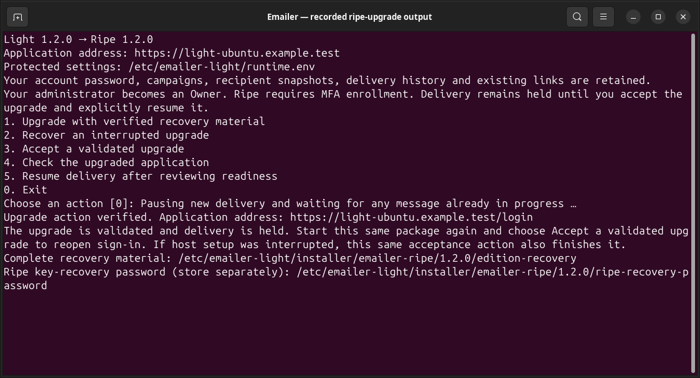
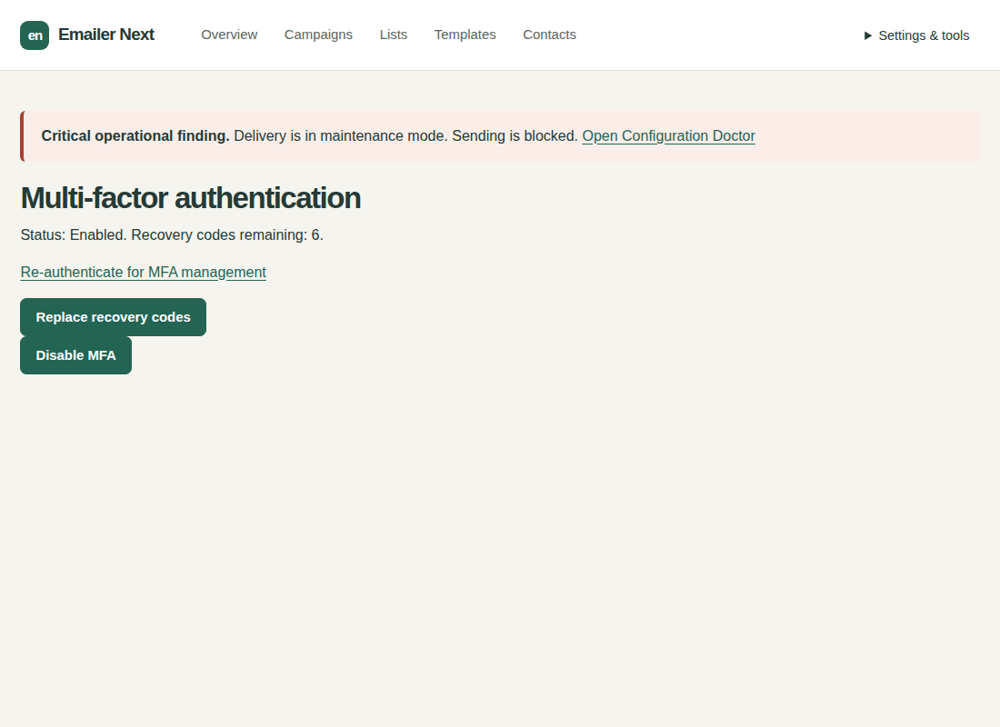
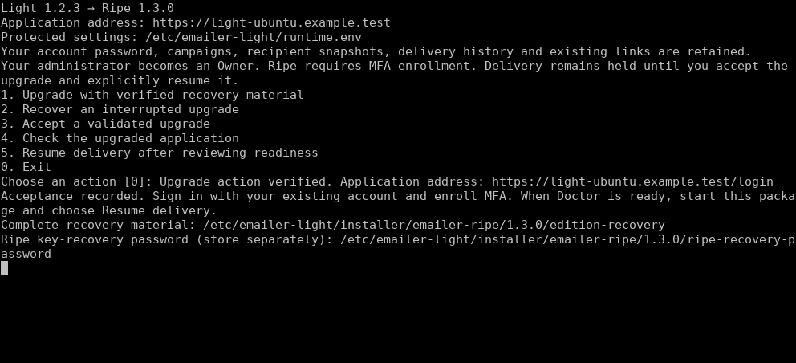

# Upgrade Emailer Light to Ripe

Ripe 1.3.4 | Beginner guide for Light 1.0.0, 1.1.0 and 1.2.0 through 1.2.7

Upgrade with the private Ripe 1.3.4 setup file. Your Light administrator becomes an Owner and keeps the same password. Delivery remains held until you accept the validated upgrade, check the result and deliberately resume.

Ubuntu 26.04 uses its maintained distribution PHP 8.5 packages; no external PHP source is added. A compatible existing MariaDB 10.11 or 11.8 service is reused without a major upgrade. Setup adds a dedicated Emailer PHP-FPM pool and keeps existing website pools, PHP alternatives and Virtualmin-managed websites in place. Missing PHP extension packages add their standard extension configuration; existing PHP settings are retained and shared PHP services are not restarted.

Ubuntu 26.04.1 / Virtualmin coexistence uses a spare Emailer hostname and preserves the existing Virtualmin domains and PHP pools. Setup creates its own Apache site; it does not register a Virtualmin domain. Keep that site under Emailer installer management. Light 1.2.4 and 1.2.6 on Ubuntu 26.04 upgrade directly to Ripe 1.3.4; the original Light signing identity, administrator credentials and installation identity are retained. Delivery remains held until the guided readiness acceptance.

Ubuntu 26.04.1 HTTPS acceptance used a local ACME server with real HTTP challenge validation and strict certificate/name verification. Public certificate issuance remains unverified because no dedicated non-production hostname and DNS authority were available. Customer setup uses the normal public ACME service; DNS must point to the server and Apache must be reachable on ports 80 and 443.

## Supported sources

| Installed source | Target and route |
| --- | --- |
| Original published Light 1.0.0 | Ripe 1.3.3, direct guided upgrade. |
| Official Light 1.1.0 | Ripe 1.3.3, direct guided upgrade. |
| Official Light 1.2.0 | Ripe 1.3.3, direct guided upgrade. |
| Official Light 1.2.1 | Ripe 1.3.3, direct guided upgrade. |
| Official Light 1.2.2 | Ripe 1.3.3, direct guided upgrade. |
| Official Light 1.2.3 | Ripe 1.3.3, direct guided upgrade. |
| Official Light 1.2.4 | Ripe 1.3.3, direct guided upgrade. |
| Official Light 1.2.5 | Ripe 1.3.3, direct guided upgrade. |
| Official Light 1.2.6 | Ripe 1.3.3, direct guided upgrade. |
| Official Light 1.2.7 | Ripe 1.3.3, direct guided upgrade. |
| Light updated through a supported path to any supported source above | Ripe 1.3.3, same guided edition upgrade. |
| Ripe 1.0.6, 1.1.0, 1.2.1, 1.2.2, 1.3.0, 1.3.1 or 1.3.2 | Ripe 1.3.3, normal Update menu instead. |

Use the Ripe 1.3.4 installer for the ten supported Light versions: original 1.0.0, 1.1.0 and 1.2.0 through 1.2.7. Earlier Ripe releases do not automatically recognize newer Light packages. The new installer authenticates each explicit source with the established Light identity and checks its exact schema. Original Light 1.0.0 remains supported. There is no general Ripe-to-Light downgrade.

Use Ubuntu 22.04/24.04/26.04 amd64/systemd with Apache, or Debian 13 with Nginx, PHP 8.4 (PHP 8.5 on Ubuntu 26.04) and supported MariaDB 10.11/11.8. Ubuntu 22.04 fresh installations use an isolated MariaDB 10.11.19 beside any existing host database. The installer discovers protected standard settings under /etc/emailer-light or /etc/emailer, a dedicated application database account, private/key storage and an existing trusted HTTPS hostname without a custom port/subfolder. A dedicated Emailer virtual-host file must not also serve unrelated routes or applications. Unknown customized targets stop before handoff; keep their existing configuration. The automatic handoff requires the recorded dedicated Emailer PHP-FPM service so it can drain only this application. A shared/custom PHP service is preserved and rejected before hold or website mutation; use the operator reference for a supervised quiescent handoff.

## 1. Prepare for maintenance

Finish intentional sending and allow a short maintenance period. Keep the current HTTPS address and signing keys. Know the existing administrator login and password. If the database needs a separate administrator sign-in, have it ready for the hidden conditional prompt. Setup itself pauses delivery, waits for in-flight work, backs up and verifies recovery material, and fences the old application account. No migration commands or service files need to be written.

## 2. Download and start Ripe setup

While signed in with access, download **emailer-ripe-1.3.4-setup.run** from the [official private release](https://github.com/Attory/emailer-next/releases/tag/v1.3.4), or use an authorized private copy. Upload that one file to the existing server through your provider's file-transfer facility. Do not put a GitHub token in a shell command. In the folder containing the file, run:

```bash
sudo sh emailer-ripe-1.3.4-setup.run
```

Initial trust comes from the official HTTPS or authorized private delivery channel. Embedded established signing identities authenticate the Ripe package and all ten supported Light predecessor packages. You do not need to assemble verifier source, sidecars, version arguments or commit hashes.

## 3. Select and upgrade

If asked about an existing Light installation, choose **Upgrade this Light installation to Ripe**. If both standard installations are found, select the intended address when asked. A custom or unrecognized target stops without adoption. Check the displayed Light version and address, then choose **Upgrade with verified recovery material**. Wait for named progress and validation. Retain the printed recovery location.



If interrupted, start the same file and choose **Recover an interrupted upgrade** before retrying. If the message says conversion committed, follow its Accept instruction. Never delete operation journals or edit migration records to retry.

## 4. Accept the validated upgrade, then sign in

1. After the automatic validation succeeds, start the same setup file again and choose **Accept a validated upgrade**. This completes the host handoff and reopens sign-in. The public site stays under maintenance until this action; delivery remains held separately.
2. Open the existing HTTPS login address and use your unchanged administrator login and password. Old sessions are revoked; the account is now an Owner.
3. Check campaigns, templates, assets, recipient snapshots, delivery/tracking history, suppressions and existing links. Campaign-owned Light recipients remain campaign-owned; no contacts or list memberships are manufactured.

The transition preserves the password hash, installation identity, SMTP credentials and encryption/token contexts, relevant backups and required audit history. No campaign is approved or newsletter sent as an upgrade side effect. After acceptance, recovery cannot be replayed as a downgrade.

## 5. Complete security and mail checks

Light upgrades start Ripe at High security with MFA unenrolled. Open Settings & tools > MFA, confirm your credentials, start enrollment, add its setup key to an authenticator app, save the recovery codes privately and confirm a current code. Do not share that secret screen.



Open Mail settings. Existing SMTP settings should be retained. Choose **Test saved connection** to validate the retained TLS and sign-in without sending. When editing settings, **Test connection without sending** uses the visible current fields; an unsaved success requires an explicit **Save SMTP settings**. Connection tests work while delivery is held. If Light never had SMTP, you can keep preparing drafts and add it later. Sending a test message is a separate explicit action with a shown destination and respects the delivery hold.

## 6. Resume when ready

Resolve Doctor's sending blockers and review previously approved or scheduled campaigns: lifting the hold can allow existing due work to continue. Start the same setup file, choose **Resume delivery after reviewing readiness** and answer yes. All normal sending checks must pass. The action does not approve any draft.



If you are not ready, exit; drafting remains available. Keep recovery material after acceptance.

## If something stops

| Situation | Action |
| --- | --- |
| Delivery still has active work | Let the current message finish and retry. Never reset claims manually. |
| Package, version or schema mismatch | Retain source/recovery files and use the original official package. Do not replace signing keys or migration records. |
| Interrupted before commit | Choose Recover, verify the restored source, then retry. |
| Committed conversion | Choose Accept a validated upgrade. A completed operation cannot be downgraded by recovery. |
| Resume blocked | Open Doctor, complete MFA/mail settings and resolve the named finding, then retry Resume. |

Continue with the [Ripe manual](emailer-ripe-manual.md). Use the [operator reference](emailer-ripe-operator.md) for exceptional host and recovery cases.
