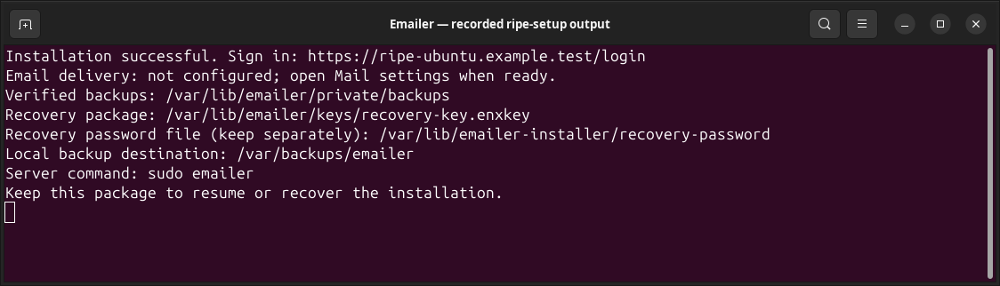
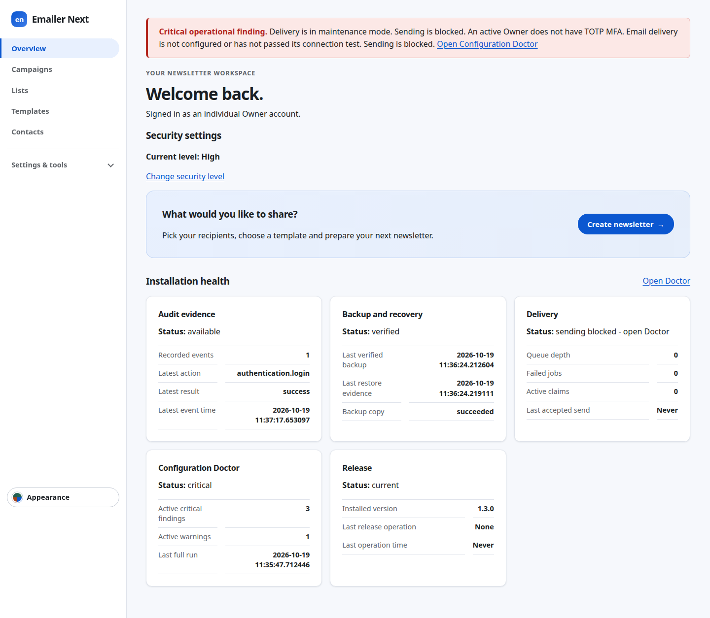
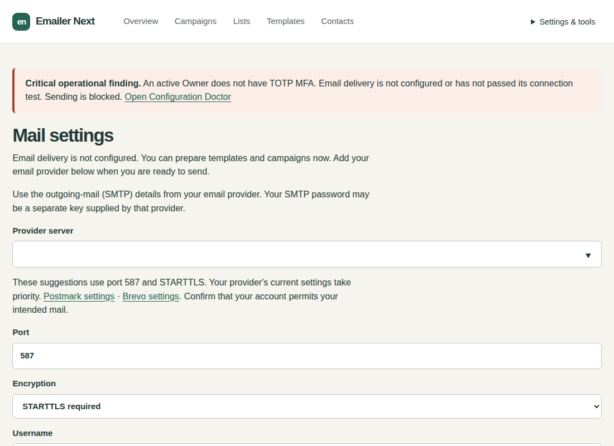
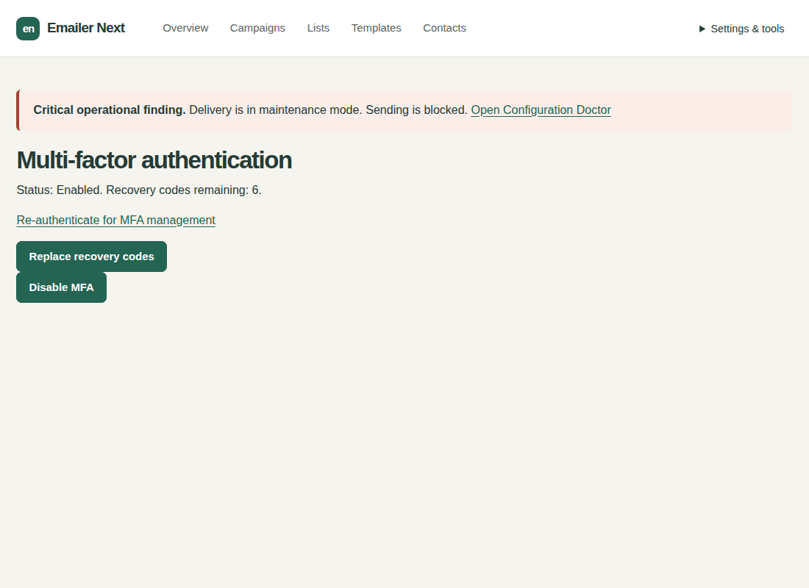

# Install Emailer Ripe

Version 1.3.5 | Beginner guide | Ubuntu Apache or Debian Nginx VPS

Install a usable Emailer Ripe website with one guided server setup. You need your administrator email, a new password, and the address you want people to use. Email delivery can wait.

Ubuntu 26.04 uses its maintained distribution PHP 8.5 packages; no external PHP source is added. A compatible existing MariaDB 10.11 or 11.8 service is reused without a major upgrade. Setup adds a dedicated Emailer PHP-FPM pool and keeps existing website pools, PHP alternatives and Virtualmin-managed websites in place. Missing PHP extension packages add their standard extension configuration; existing PHP settings are retained and shared PHP services are not restarted.

Ubuntu 26.04.1 / Virtualmin coexistence uses a spare Emailer hostname and preserves the existing Virtualmin domains and PHP pools. Setup creates its own Apache site; it does not register a Virtualmin domain. Keep that site under Emailer installer management. Light 1.2.4 and 1.2.6 on Ubuntu 26.04 upgrade directly to Ripe 1.3.5; the original Light signing identity, administrator credentials and installation identity are retained. Delivery remains held until the guided readiness acceptance.

Ubuntu 26.04.1 HTTPS acceptance used a local ACME server with real HTTP challenge validation and strict certificate/name verification. Public certificate issuance remains unverified because no dedicated non-production hostname and DNS authority were available. Customer setup uses the normal public ACME service; DNS must point to the server and Apache must be reachable on ports 80 and 443.

Ubuntu Apache can coexist with Nginx on a separate port (tested: 8081). Setup manages only Apache and the Emailer instance. Every existing listener on ports 80 and 443 must belong to apache2.service; a different service on either port or an overlapping Emailer hostname stops setup with existing services preserved. Ripe additionally supports literal IPv4/IPv6 Apache virtual hosts on explicit ports 80 and 443. Fresh setup joins the existing address groups automatically. Updates and Light upgrades retain the existing Emailer site’s address bindings. Its dedicated file must group addresses into at most one VirtualHost block per port; custom routing or separate blocks on the same port require operator preparation. Wildcard-port virtual hosts (IP:*) and scoped addresses are unsupported; setup stops before changing websites.

## Who can use this guide?

Use a virtual server with Ubuntu 22.04 LTS, 24.04 LTS or 26.04 LTS and Apache, or Debian 13 and Nginx. It must be amd64/x86-64, use systemd, and let you run sudo. Setup chooses Apache on a clean Ubuntu host and Nginx on a clean Debian 13 host. Earlier profiles were tested with 2 CPU cores, 3 GB memory and a 24 GB disk. The Ubuntu 26.04.1 Virtualmin fixture has 4 CPU cores, 6 GB memory and a 40 GB disk. Ubuntu 22.04 needs at least 5 GiB free; other supported profiles need 2 GiB. Leave additional space for uploads and backups.

An existing Apache website using PHP 8.1 can stay on Ubuntu 22.04, including its existing database and unrelated services. Give Emailer a spare hostname. Setup adds its own PHP runtime and application services without changing the existing website’s PHP selection. Ubuntu 22.04 also gets a separate supported database; it does not upgrade an older shared database. Ubuntu 24.04, Ubuntu 26.04 and Debian 13 reuse a compatible local MariaDB server. An incompatible existing database on those profiles stops setup before packages change.

| Tested server | Website software | Handled automatically |
| --- | --- | --- |
| Ubuntu 22.04.5 LTS, amd64/systemd | Apache 2.4.52 | PHP 8.4.26; dedicated MariaDB 10.11.19 alongside the host database |
| Ubuntu 24.04.5 LTS, amd64/systemd | Apache 2.4.58 | PHP 8.4.26; distribution MariaDB 10.11.14 |
| Ubuntu 26.04.1 LTS, amd64/systemd | Apache 2.4.66; Virtualmin 8.3.0 / Webmin 2.670 | Distribution PHP 8.5.4-0ubuntu1.5; MariaDB 11.8.6-5ubuntu0.1; dedicated Emailer PHP-FPM pool |
| Debian 13 Trixie, amd64/systemd | Nginx 1.26.3 | PHP 8.4.26; MariaDB 11.8.6 |

Only these OS/web-server combinations are supported. Ubuntu using Nginx as its public web server on ports 80/443, Debian 13 with Apache, ARM, custom website ports/subfolders and ordinary file-upload hosting are outside this installer’s tested scope. On a VPS that also hosts other websites, Emailer needs its own dedicated hostname; existing websites retain their configuration and operation.

Ordinary file-upload/shared hosting cannot run this installer: Emailer needs a persistent background worker, scheduled services and private key storage outside the website. Uploading PHP files alone cannot provide these requirements. Use the supported VPS path.

On Ubuntu 22.04 and 24.04, setup adds the maintained Ondřej Surý PHP package source and verifies its signing identity automatically. Ubuntu 22.04’s separate database receives security patches through reviewed Emailer maintenance releases, rather than the server’s ordinary package updates. Keep Emailer maintenance releases current; you do not need to assemble or configure the database yourself.

## 1. Get your server and website address ready

Sign in to your hosting provider's server console or use its SSH instructions. This is the terminal where you paste the setup action below. You need the provider's server sign-in; it is separate from the new Emailer account.

Choose a spare address such as `news.your-domain.com`. In your domain provider's DNS controls, point its A record to this server's public IPv4 address. Add an AAAA record only if this server actually accepts public IPv6. Allow incoming TCP ports 80 and 443 in the hosting firewall. Do not take over an existing website address. Setup cannot edit your domain or hosting-provider account without access to that account.

## 2. Download the official setup package

While signed in to GitHub with access to the private [Emailer Ripe release](https://github.com/Attory/emailer-next/releases/tag/v1.3.5), download **emailer-ripe-1.3.5-setup.run**. Upload that one file to the server using your provider's file-transfer facility. An authorized privately supplied copy of the same signed setup file also works. Keep the file private. Do not paste a GitHub token or repository password into a download command.

You do not need a source checkout, Composer, a public-key file or separate verification sidecars. Those components are inside the setup package.

Initial trust comes from obtaining the setup action itself from the official HTTPS release or an authorized private channel. Its embedded, established edition signing identity then verifies the package inventory, runtime and release identity before installer code runs. A key supplied beside an arbitrary download would not establish that initial trust.

Ubuntu 22.04 also retrieves an authenticated MariaDB runtime of about 360 MB. Allow time for this download; progress is saved and an interrupted download resumes when you start the same setup file again. No container software or Composer command is needed.

## 3. Start setup

From the folder containing the downloaded file, paste this single setup action:

```bash
sudo sh emailer-ripe-1.3.5-setup.run
```

If setup finds an existing Light installation, choose **Install a separate fresh Ripe application** for this fresh-install guide. Choose its upgrade option only when you intend to convert Light, following the separate upgrade guide. The fresh Ripe site needs a different dedicated hostname.

sudo may ask for your server account password once. Setup needs host permission to install services; the application itself runs under a dedicated account. Keep the terminal open. Password entry is hidden, so no letters or dots may appear.

1. Enter **Application hostname** if asked: just your dedicated address, without https://, a port or a path. Setup does not assume the machine's name is a public website.
2. Enter **Owner email**. This becomes your sign-in name.
3. Enter a strong **Owner password** and enter it again. Use 15-256 characters.
4. On Ubuntu 22.04 fresh setup creates its own database without asking for database details. On Ubuntu 24.04, Ubuntu 26.04 or Debian 13, enter a database administrator sign-in only if the existing local MariaDB server needs it; passwords are hidden.

You will see named progress steps for dependencies, package verification, private folders, database and account, services, backup/recovery, HTTPS and health. Organisation name defaults to Emailer; language to English and scheduling timezone to UTC. SMTP details are not required.



## 4. Sign in

Wait for **Installation successful**. Open the printed HTTPS login address in your browser and sign in with the email and password you entered. Setup has already installed the worker, scheduler, maintenance jobs and command launcher and verified the initial backup. Do not proceed past a browser certificate warning; use the HTTPS troubleshooting entry below. Fresh Ripe uses Studio; open Appearance to preview the other skins.



## 5. Configure email now or later

You can prepare templates and draft campaigns immediately. **Email delivery is not configured** means actual sending is blocked. No campaign is approved or sent during installation.

When ready, open **Settings & tools > Mail settings** and enter your provider details. **Test connection without sending** tests the current visible fields without saving or emailing anyone. If it says Current settings tested successfully—save to apply, choose **Save SMTP settings**. A blank password reuses a saved password only for the same host and username. **Test saved connection** checks only the already-saved configuration. To send one requested message, enter your own address in **Test destination** and explicitly choose **Send test email**. See the [user manual](emailer-ripe-manual.md) for examples and error guidance.



Ripe starts at High security. Before sending, open **Settings & tools > MFA**, confirm your current credentials when asked, and start enrollment. Add the displayed setup key to an authenticator app, save the recovery codes privately, enter its current code and confirm. Treat that screen as secret; do not share a screenshot. Existing accounts keep their login identifiers.



## 6. Keep your recovery information

The completion summary gives your verified backup folder, local backup destination, encrypted recovery-key package and protected recovery-password file. These paths are created automatically. Keep a separate, securely stored copy of the recovery package and its password, using different protected locations. A backup on the same server cannot protect you from losing the server.

For a fresh Ripe installation, backups are under `/var/lib/emailer/private/backups`, the local destination is `/var/backups/emailer`, the recovery package is `/var/lib/emailer/keys/recovery-key.enxkey`, and the password is `/var/lib/emailer-installer/recovery-password`. Host permission is needed to read the password. Never paste it into a support ticket. After updates or edition changes, use the locations printed by that operation.

## If setup stops

| What you see | Smallest next action |
| --- | --- |
| Address/DNS or HTTPS validation failed | Correct the domain records and provider firewall for this server, then run the same setup action again. Saved progress is retained. HTTPS is complete only after validation succeeds. |
| Another service owns port 80 or 443 | Keep that service running. Existing supported Apache/Nginx sites can coexist; a different service owning the web ports needs a separate supported VPS. Setup does not stop unrelated services. |
| Existing database is incompatible | Ubuntu 22.04 provisions its own isolated database. On Ubuntu 24.04, Ubuntu 26.04 or Debian 13, an incompatible existing server is preserved; use the supported separate VPS profile rather than upgrading a shared database during setup. |
| Signed OS package catalogue cannot be used | Check the server clock, internet connection and configured OS repositories. Setup does not bypass signature checks. Keep the same setup file and retry. |
| Package authenticity or integrity verification failed | Delete only the failed download, obtain a fresh official setup file, and retry. Keep any existing application and recovery files. |
| Setup interrupted | Run the same action again. It resumes the recorded setup; it does not create another administrator or reset an existing database. |

Run setup again for installation management. **Check the installation** is safe to repeat; an installed update preserves settings and delivery state. For other errors, read the [operator and troubleshooting reference](emailer-ripe-operator.md). Keep installer state and database files when retrying. Next: [Ripe user manual](emailer-ripe-manual.md).

## Installer holds and owner pauses

A successful operation releases only its own temporary installer hold after runtime verification and any required Accept action. An independent owner pause or another operation hold remains. Doctor reports the actual MFA, SMTP or other readiness requirement instead of calling a completed installation unfinished. Completing a requirement can allow previously approved due work to continue if the owner already enabled delivery; inspect that work before changing readiness.

An interrupted or recovered operation retains its operation identifier, lifecycle and Finish or Recover action. Use the same verified setup and retained recovery material. Failed and uncertain messages are never retried by completion. An unattributed legacy hold remains unknown until its owner explicitly reviews and resumes it; a zero delivery flag alone never proves installer ownership.

## Scan an authenticator QR code privately

After confirming current credentials for MFA management, choose Start or restart enrollment. In a standard authenticator choose Add account and Scan QR code; scan the displayed code. If scanning is unavailable, choose manual entry and copy the adjacent setup key. Both represent the same account. Store recovery codes privately and confirm a current six-digit code. QR generation happens locally; no external QR service is contacted. Do not share or capture the enrollment screen. Existing enrolled accounts keep their factor and do not enrol again.
