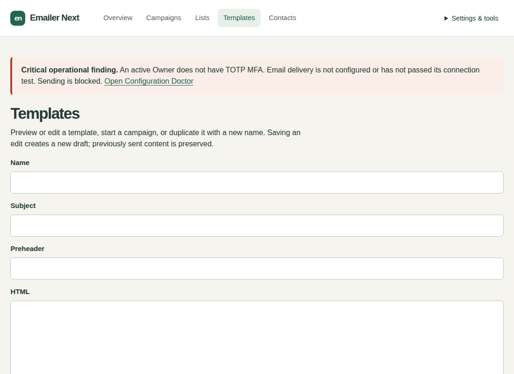

# Emailer Ripe user manual

Version 1.2.3 | Accounts, setup and everyday newsletters

Prepare, test, approve, then send. Saving a draft sends nothing. A campaign is one newsletter, a template is reusable content, and a list is a group of contacts.

Ripe’s Ubuntu Apache installer supports wildcard and literal address-specific virtual hosts on explicit ports 80 and 443. Light retains a wildcard-only Apache profile. An existing Nginx service on a separate port, such as 8081, remains unchanged.

The 1.2.3 setup file supports Ubuntu 22.04/24.04 with Apache and Debian 13 with Nginx. It creates a dedicated PHP runtime, application services, backups and a command launcher. Ubuntu 22.04 gets an isolated supported database beside existing sites. Administrator email is the default login name on fresh setup; existing accounts keep their identifier and password. You can sign in, prepare templates and campaigns, and configure SMTP later. See the beginner installation guide for the tested hosting profile and one-file setup action.

## Your installed account

The [fresh installer](emailer-ripe-install.md) creates an Owner using your administrator email. Existing accounts keep their identifiers and password hashes. For Light transitions, follow the [upgrade guide](emailer-light-to-ripe-upgrade.md). Fresh organisation defaults are Emailer, English and UTC. The installer installs background services and an initial encrypted backup. You can prepare content and drafts while sending is blocked.

## Secure your Owner account

1. Open Settings & tools > MFA. Confirm your current credentials when asked and start enrollment.
2. Add the displayed setup key to an authenticator app. Store its recovery codes privately before confirming. Enter a current authenticator code and confirm MFA. Do not share the enrollment screen.
3. On future sign-ins supply your password and current authenticator code, or one unused recovery code. Recovery codes work once.

High is the fresh and Light-upgrade default. Sensitive actions ask for your own credentials for the named purpose; confirmation lasts five minutes. Normal is an explicit Owner choice under Security. It removes those additional prompts but keeps login, configured MFA, roles, CSRF and auditing. Keep an unlocked Owner session under your control. Native Ripe updates retain the existing security policy.

## Configure email now or later

1. Open Settings & tools > Mail settings. Enter your provider server, port, STARTTLS/direct TLS, username, SMTP password/key and permitted sender address. Sender name and reply-to are optional.
2. Choose Store secure SMTP configuration. If asked, enter your own Owner password and authenticator/recovery code, then Confirm and store. Saving encrypts settings and sends nothing.
3. Choose Test connection without sending to validate the certificate and sign-in without emailing anyone.
4. For one message, enter your own address in Test destination, check it, then choose Send test email. This never approves or sends a campaign.

A blank SMTP password retains the saved password only for the same server and username. A new server or login needs its password. Provider suggestions are conveniences. Leave the optional one-click DKIM attestation unticked unless your provider confirms signing both unsubscribe headers.

## Roles and additional accounts

| Role | Responsibility |
| --- | --- |
| Owner | Full access, recovery, protected Owner changes, security policy and upgrade acceptance. |
| Administrator | Configuration and users within the protected Owner boundary; campaign approval. |
| Operator | Contacts, lists, templates, drafts, tests and sending approved campaigns. |
| Auditor | Read-only redacted campaigns, health, reports and audit. |

An Owner or Administrator opens Settings & tools > Users, enters the new account email and initial password, selects Operator and creates it. Identity confirmation uses your own current password and code, not the new account password. At least one active Owner remains.

## Create and edit a newsletter

1. Open Campaigns > Create newsletter. You can also use Send to beside a list or Send beside a template.
2. Recipients: give the campaign an internal name and choose existing lists, or upload CSV into a new named list and map its email column. This name is not the subject. Only contact people you have permission to email.
3. Content: choose and preview a saved template, or upload/paste HTML. New content needs a template name and subject. The optional preheader is the preview beside the subject in many inboxes.
4. Sending rate: leave blank to inherit the installation maximum or enter a lower messages-per-minute rate. Domain limits and retries can add time.
5. Review and save. For uploaded CSV, review counts and choose Add reviewed recipients before testing or approval.

Duplicates and global unsubscribes are excluded. Reimporting or duplicating lists does not remove unsubscribe protection. Upgraded Light campaigns keep their campaign-owned recipient snapshots; conversion does not manufacture reusable contacts or lists.

For Draft or Review, open the campaign and choose Edit draft after committing pending imports. Edit its name, lists, template version or rate; saving Review returns it to Draft. For wording changes, save a new template version, explicitly select it in Edit draft and send a fresh test. Approval locks content and audience; changed approved work needs a new campaign.

## Test, approve and send

1. Choose Send a test to myself. It uses your signed-in account email. Wait for acceptance and inspect the actual message, links and unsubscribe footer. Changed drafts need a new test.
2. Choose Review newsletter and check eligible/suppressed counts, template, sender, timezone, tracking and RSVP. The final audience is recorded at approval.
3. An Administrator or Owner chooses Approve newsletter and confirms their own credentials when asked. Operators need an approver.
4. Choose Send now or set a date/time and Schedule newsletter. Use the displayed organisation timezone. Approval alone does not start delivery.

## Progress, templates and reports

- SMTP accepted means accepted by the mail server, not proven inbox placement. Waiting/retries may reflect rate limits or temporary provider failures.
- Pause stops new claims; in-flight messages can finish. Adjust the rate while paused and resume deliberately. Cancellation cannot recall messages already sent. Uncertain outcomes are not automatically resent.
- Owners adjust installation limits under Settings & tools > Delivery limits. Campaign rates cannot bypass them.
- Refresh the page or sign in again if counts stop refreshing. Without JavaScript use Refresh page.
- Template versions are immutable. Upload images through the asset controls; unsafe HTML, remote image sources and unsupported styling are removed. Use supported merge fields such as {{ contact.first_name }} and {{ unsubscribe_url }}.
- Unsubscribe actions suppress the represented address globally. Forwarded links affect their original recipient. Open/click tracking is approximate because of privacy tools and scanners.

## Health, backups and updates

Doctor shows each sending blocker and repair action. Native updates and edition upgrades also leave an operational hold. Use the installer's explicit Resume action after readiness passes. Previously approved due campaigns may continue when you resume; drafts are never approved automatically.

Fresh setup enables daily encrypted local backup copies. Under Backups inspect verification and transfer evidence, adjust policy or create and verify an on-demand backup. Keep the recovery-key package and its password separately. Same-server copies do not protect against server loss; arrange an independent backup destination. Restore drills are supervised, never automatic.

For Ripe 1.0.6, 1.1.0, 1.2.1 or 1.2.2 to 1.2.3, start the new official setup file, choose Update with a verified backup and follow any Finish instruction. This includes Ripe 1.1.0 installations previously converted from Light. Existing MFA, password, recipients, tracking, SMTP encryption contexts and recovery history are retained. Review Doctor before Resume. Earlier Ripe versions must follow their published supported path to 1.0.6 first. Interrupted operations use Recover; committed operations use Finish and cannot be downgraded by recovery. See the [operator reference](emailer-ripe-operator.md).
