# Emailer Ripe user manual

Version 1.3.3 | Accounts, setup and everyday newsletters

Prepare, test, approve, then send. Saving a draft sends nothing. A campaign is one newsletter, a template is reusable content, and a list is a group of contacts.

Ubuntu 26.04 uses its maintained distribution PHP 8.5 packages; no external PHP source is added. A compatible existing MariaDB 10.11 or 11.8 service is reused without a major upgrade. Setup adds a dedicated Emailer PHP-FPM pool and keeps existing website pools, PHP alternatives and Virtualmin-managed websites in place. Missing PHP extension packages add their standard extension configuration; existing PHP settings are retained and shared PHP services are not restarted.

Ubuntu 26.04.1 / Virtualmin coexistence uses a spare Emailer hostname and preserves the existing Virtualmin domains and PHP pools. Setup creates its own Apache site; it does not register a Virtualmin domain. Keep that site under Emailer installer management. Light 1.2.4 and 1.2.6 on Ubuntu 26.04 upgrade directly to Ripe 1.3.3; the original Light signing identity, administrator credentials and installation identity are retained. Delivery remains held until the guided readiness acceptance.

Ubuntu 26.04.1 HTTPS acceptance used a local ACME server with real HTTP challenge validation and strict certificate/name verification. Public certificate issuance remains unverified because no dedicated non-production hostname and DNS authority were available. Customer setup uses the normal public ACME service; DNS must point to the server and Apache must be reachable on ports 80 and 443.

Ripe’s Ubuntu Apache installer supports wildcard and literal address-specific virtual hosts on explicit ports 80 and 443. Light retains a wildcard-only Apache profile. An existing Nginx service on a separate port, such as 8081, remains unchanged.

The 1.3.3 setup file supports Ubuntu 22.04/24.04/26.04 with Apache and Debian 13 with Nginx. It creates a dedicated PHP runtime, application services, backups and a command launcher. Ubuntu 22.04 gets an isolated supported database beside existing sites. Administrator email is the default login name on fresh setup; existing accounts keep their identifier and password. You can sign in, prepare templates and campaigns, and configure SMTP later. See the beginner installation guide for the tested hosting profile and one-file setup action.

## Your installed account

The [fresh installer](emailer-ripe-install.md) creates an Owner using your administrator email. Existing accounts keep their identifiers and password hashes. For Light transitions, follow the [upgrade guide](emailer-light-to-ripe-upgrade.md). Fresh organisation defaults are Emailer, English and UTC. The installer installs background services and an initial encrypted backup. You can prepare content and drafts while sending is blocked.

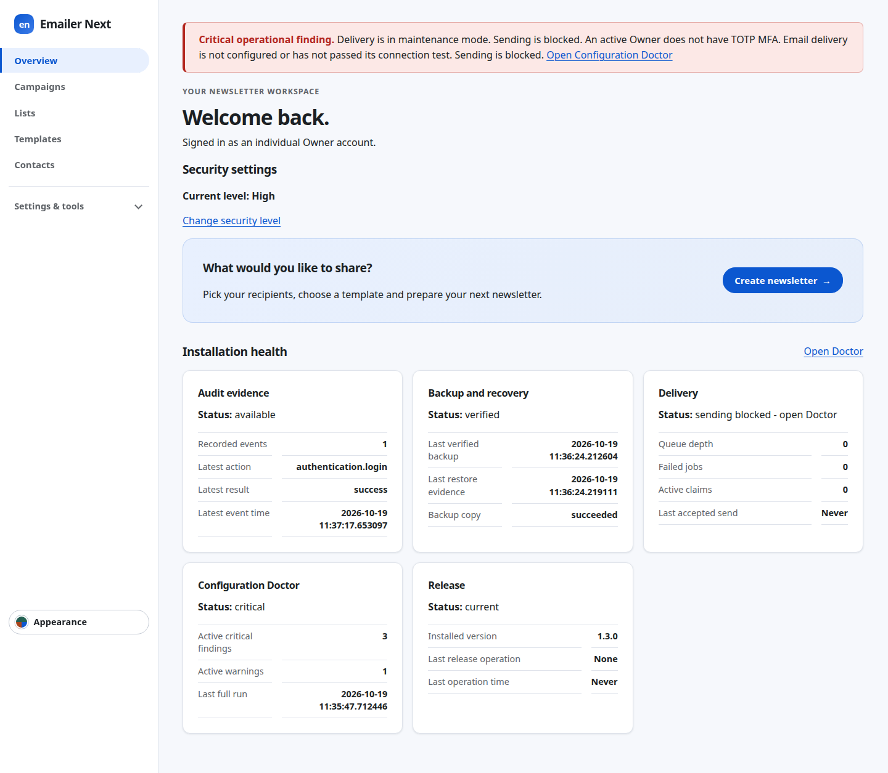

## Choose your dashboard appearance

Open <strong>Appearance</strong> in the administration header. Studio gives a crisp, structured workspace; Warm adds welcoming colours and gentle motion; Website uses saved organisation branding. Classic keeps the original look. Fresh Ripe installations start with Studio. An update or Light upgrade keeps the existing Classic appearance until you choose another skin.

1. Choose a thumbnail to preview its skin immediately. Anything you have typed on the page stays in place.
2. Choose <strong>Save appearance</strong> to keep your choice across sign-ins. Your selection affects only your account.
3. Choose <strong>Revert preview</strong>, Cancel or Escape to return to your saved appearance.
4. For less animation choose <strong>Reduce motion</strong>. Otherwise Emailer follows your device’s motion preference.

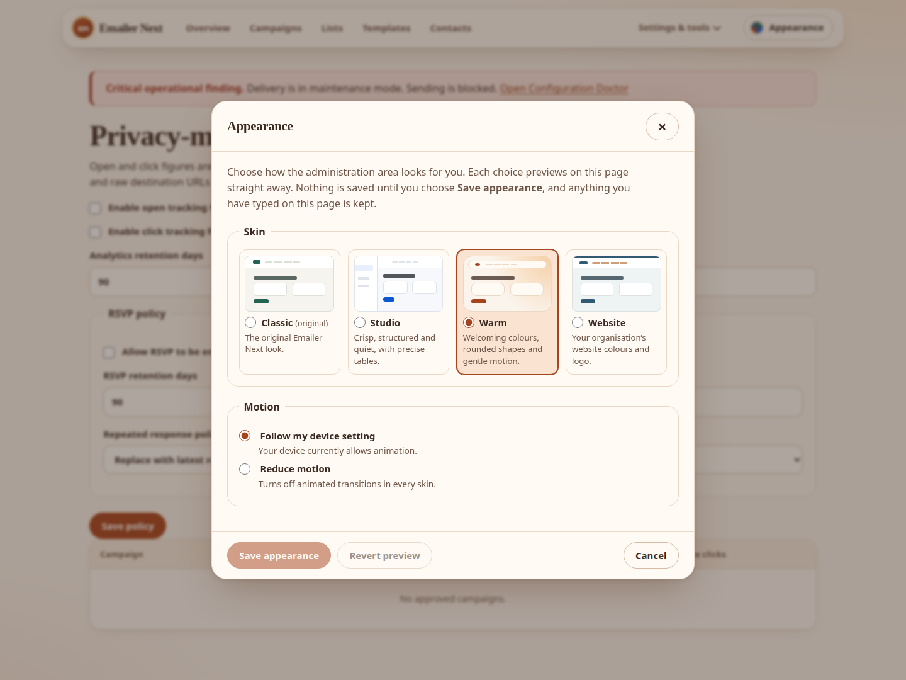

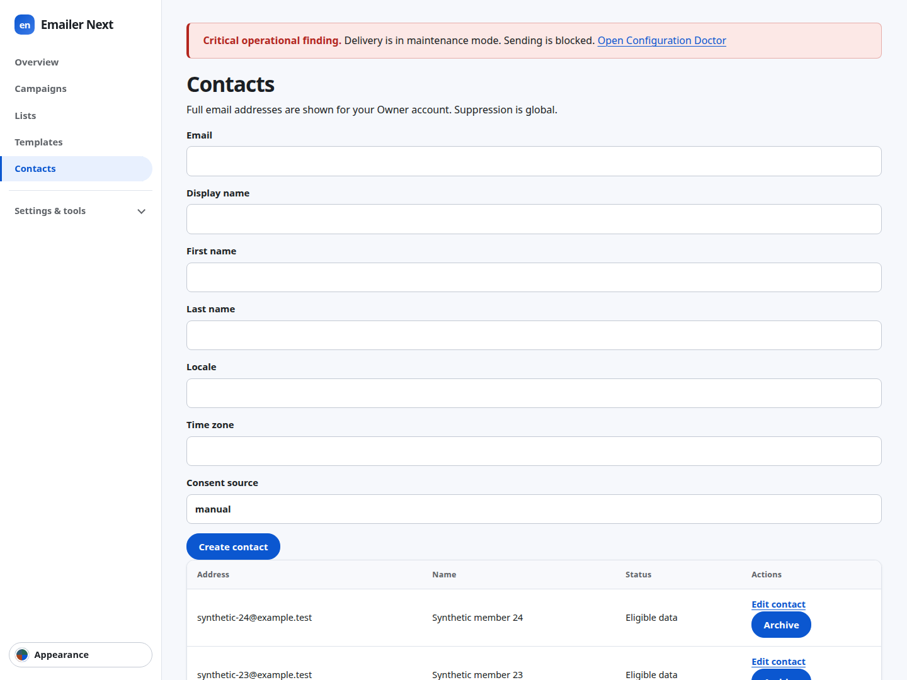

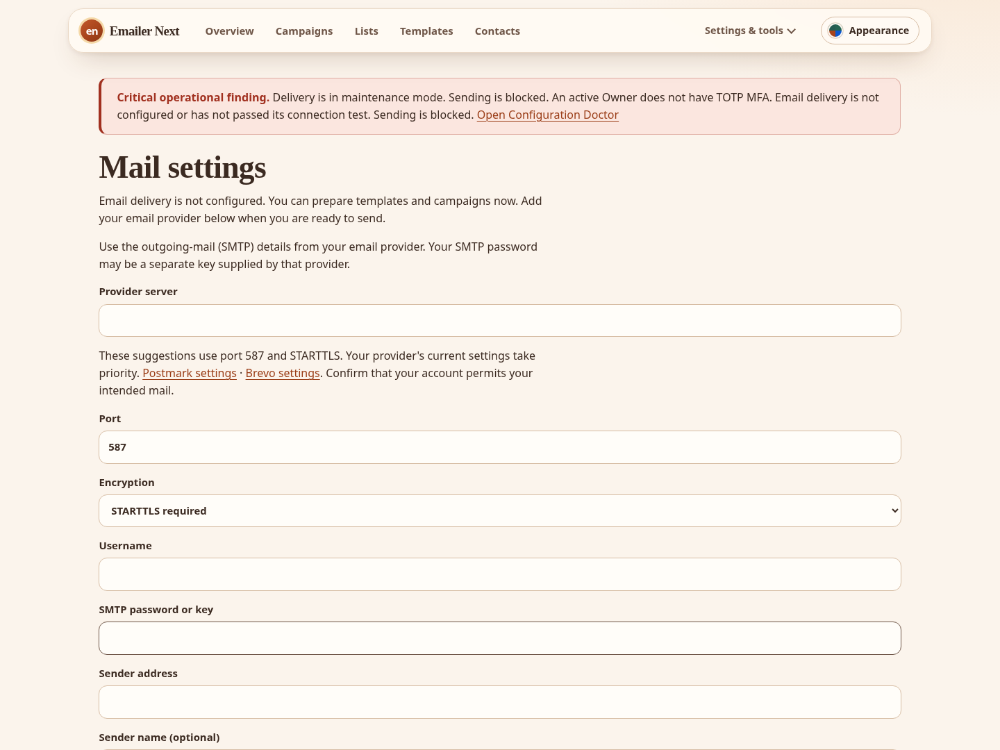

### Match your organisation website

In Appearance choose Website. An Administrator or Owner can confirm or edit the suggested address, or enter the organisation’s public HTTPS website, and choose <strong>Refresh from website and save for everyone</strong>. Confirm the organisation website rather than assuming that the Emailer dashboard address is the right source. No website is contacted until you press this button.

Emailer saves a small set of colours, a system or serif heading font and, when available, a small safe site icon. It does not copy whole pages or load the website into your dashboard. If no suitable icon is found, the text mark remains. The source address and last refresh time are displayed. Extraction suggests a coherent starting point; it cannot exactly copy every website.

1. Review the preview. Adjust Primary, Accent, Panels, Page background, Text and Headings if needed.
2. Choose <strong>Save corrected branding for everyone</strong> to share your corrections with accounts using Website. These shared branding buttons save immediately; Cancel only reverts your personal preview.
3. Use the website-fetch button again when the organisation branding changes. Emailer uses its saved copy between refreshes, including when the website is offline.
4. If a refresh fails, check the displayed website address and try again later, or use manual colours. Low-contrast text and unsafe or local website addresses are rejected with an explanation.

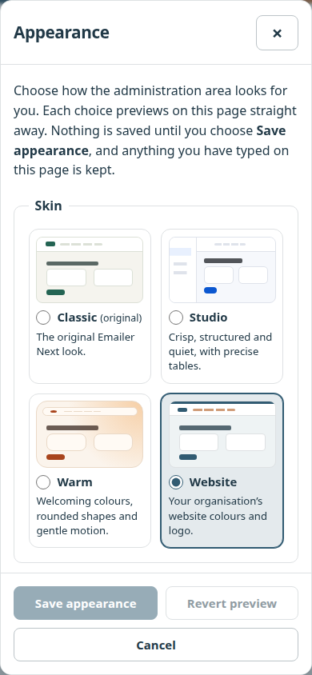

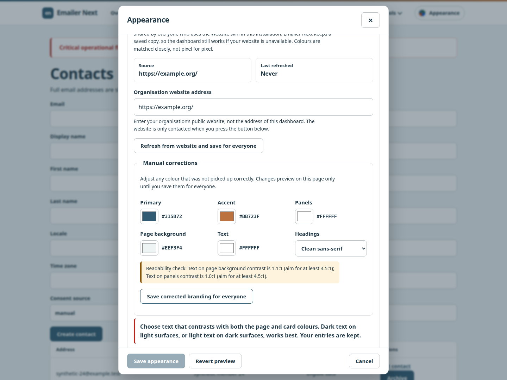

Skins affect the administration interface. They do not change newsletter HTML, the email-content preview, recipient lists, approvals, security level or delivery holds. A sending-blocked message remains visible in every skin. Appearance settings are included in the application’s encrypted backups.

## Secure your Owner account

1. Open Settings & tools > MFA. Confirm your current credentials when asked and start enrollment.
2. Add the displayed setup key to an authenticator app. Store its recovery codes privately before confirming. Enter a current authenticator code and confirm MFA. Do not share the enrollment screen.
3. On future sign-ins supply your password and current authenticator code, or one unused recovery code. Recovery codes work once.

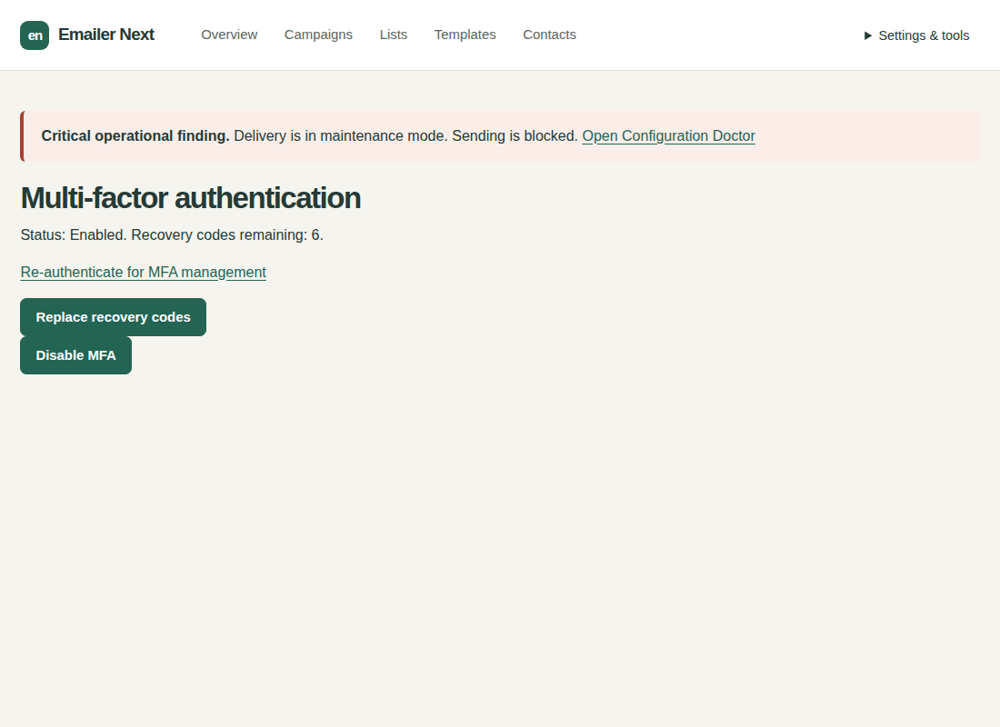

High is the fresh and Light-upgrade default. Sensitive actions ask for your own credentials for the named purpose; confirmation lasts five minutes. Normal is an explicit Owner choice under Security. It removes those additional prompts but keeps login, configured MFA, roles, CSRF and auditing. Keep an unlocked Owner session under your control. Native Ripe updates retain the existing security policy.

## Configure email now or later

1. Open Settings & tools > Mail settings. Enter your provider server, port, STARTTLS/direct TLS, username, SMTP password/key and permitted sender address. Sender name and reply-to are optional.
2. Choose Store secure SMTP configuration. If asked, enter your own Owner password and authenticator/recovery code, then Confirm and store. Saving encrypts settings and sends nothing.
3. Choose Test connection without sending to validate the certificate and sign-in without emailing anyone.
4. For one message, enter your own address in Test destination, check it, then choose Send test email. This never approves or sends a campaign.

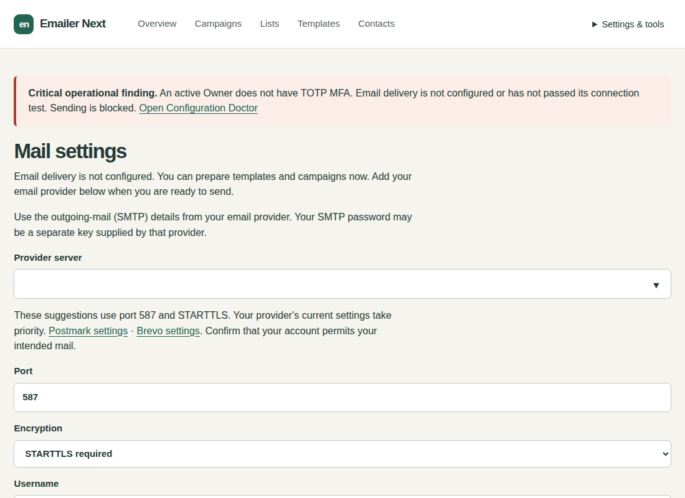

A blank SMTP password retains the saved password only for the same server and username. A new server or login needs its password. Provider suggestions are conveniences. Leave the optional one-click DKIM attestation unticked unless your provider confirms signing both unsubscribe headers.

## Roles and additional accounts

| Role | Responsibility |
| --- | --- |
| Owner | Full access, recovery, protected Owner changes, security policy and upgrade acceptance. |
| Administrator | Configuration and users within the protected Owner boundary; campaign approval. |
| Operator | Contacts, lists, templates, drafts, tests and sending approved campaigns. |
| Auditor | Read-only redacted campaigns, health, reports and audit. |

An Owner or Administrator opens Settings & tools > Users, enters the new account email and initial password, selects Operator and creates it. Identity confirmation uses your own current password and code, not the new account password. At least one active Owner remains.

## Create a campaign

1. Open Your campaigns. Under Create a campaign enter an internal campaign name, optionally set a sending rate and choose a saved template. The name is not the email subject. Leave the rate blank to use the installation maximum.
2. Choose a recipient CSV. It belongs only to this campaign; saving it does not create a reusable contact or recipient list. Use a headered CSV, or open CSV options for a headerless file and 1-based column mappings. Alternatively select Existing lists to use your saved contact lists.
3. Choose Save draft. You can save before selecting a template, and even before giving the campaign a name. Review imported, duplicate, invalid and suppressed counts after saving. Existing saved recipients remain when you save without choosing a replacement CSV. Only contact people you have permission to email.
4. Open the campaign summary to see anything still required. Review and approval remain unavailable until there is a name, a published template and eligible recipients. A saved template draft appears in the selector but must be explicitly published in Templates before testing or review.

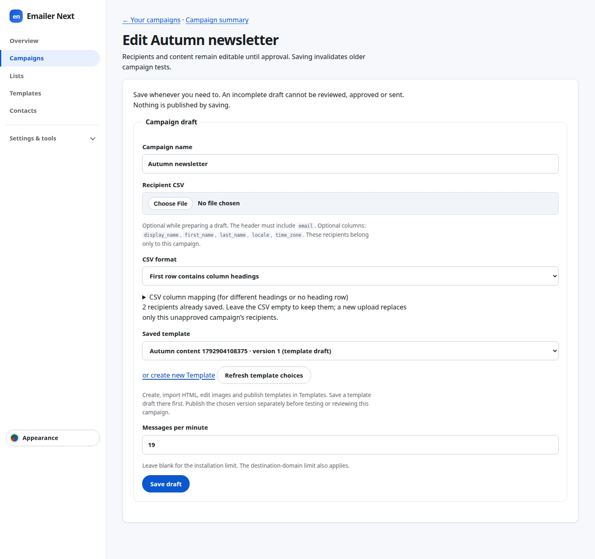

### Create a template and return

Next to the template selector choose **or create new Template**. A blank, unchanged campaign opens Templates directly. With unsaved changes the dialog asks **Save your Campaign draft before leaving?**

- Save draft and open Templates saves the name, rate and selected CSV, even without a template. After successful saving, Templates shows Return to campaign draft.
- Leave without saving opens Templates and discards your unsaved changes. Previously saved campaign data remains.
- Stay here, or Escape, closes the dialog and keeps the form and selected file.

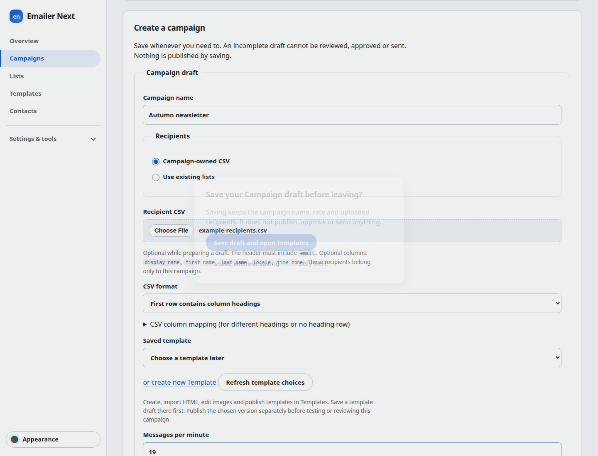

In Templates use the dedicated editor to enter or import HTML, add images from the persistent gallery and choose Save template draft. Choose Publish explicitly when ready. Then choose Return to campaign draft. The campaign reopens with its saved name, rate and recipients and fresh template choices. Choose the new version and Save draft. If Templates is open in another tab, return to the campaign tab and choose Refresh template choices; this refreshes only the selector and keeps your unsaved fields and selected CSV.

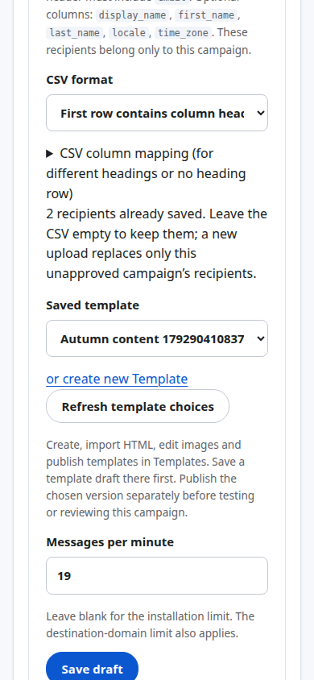

### If campaign saving fails

Stay on the form, read the specific error, correct it and try Save draft again. With JavaScript enabled, validation and connection failures keep the actual selected CSV and entered fields. If your session expired, sign in in another tab, return here and choose Refresh security check before retrying. A connection failure may mean the result could not be confirmed; check Your campaigns in another tab before creating a second campaign.

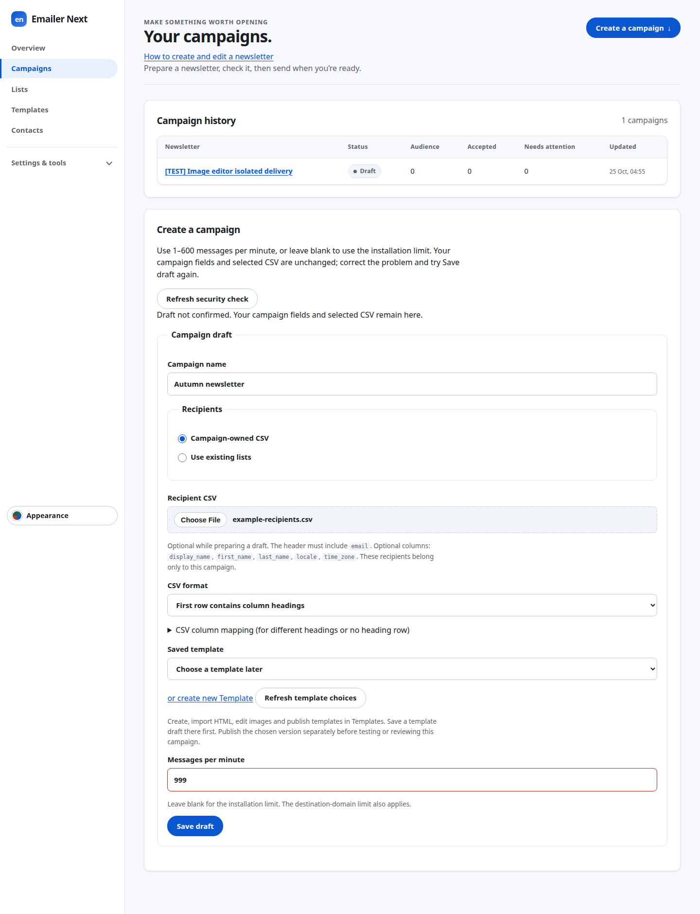

Save draft before refreshing or closing the campaign tab: unsaved navigation triggers a browser warning. Campaign files are not stored in browser draft recovery. Without JavaScript, a failed full-page submission retains text but the browser requires you to select the CSV again. Template editor recovery is separate and retains its five text fields per tab. Saving or navigating never publishes content, approves a campaign or sends email.

While Draft or Review, use Edit draft to change the campaign. Saving Review returns it to Draft and invalidates its earlier test. A replacement CSV replaces only that campaign's owned recipients. Approved content and audience snapshots stay immutable; changed approved work needs a new campaign.

## Test, approve and send

1. Choose Send a test to myself. It uses your signed-in account email. Wait for acceptance and inspect the actual message, links and unsubscribe footer. Changed drafts need a new test.
2. Choose Review newsletter and check eligible/suppressed counts, template, sender, timezone, tracking and RSVP. The final audience is recorded at approval.
3. An Administrator or Owner chooses Approve newsletter and confirms their own credentials when asked. Operators need an approver.
4. Choose Send now or set a date/time and Schedule newsletter. Use the displayed organisation timezone. Approval alone does not start delivery.

## Progress and reports

- SMTP accepted means accepted by the mail server, not proven inbox placement. Waiting/retries may reflect rate limits or temporary provider failures.
- Pause stops new claims; in-flight messages can finish. Adjust the rate while paused and resume deliberately. Cancellation cannot recall messages already sent. Uncertain outcomes are not automatically resent.
- Owners adjust installation limits under Settings & tools > Delivery limits. Campaign rates cannot bypass them.
- Refresh the page or sign in again if counts stop refreshing. Without JavaScript use Refresh page.
- Unsubscribe actions suppress the represented address globally. Forwarded links affect their original recipient. Open/click tracking is approximate because of privacy tools and scanners.

## Create or edit a template with images

Open Templates to create a draft, or choose Edit for an existing template. Enter the name, subject, optional preheader and HTML. Plain text is optional; leave it blank to generate it when saving. Your image controls are part of this same editor.

1. In Images, choose a JPEG, PNG or WebP file and select Upload and re-encode image. Stay on this page: progress is shown while Emailer validates and saves the image. Uploading keeps your five template fields and HTML cursor position.
2. Choose the saved thumbnail in the gallery. Earlier uploads are available here too; use Refresh gallery or Load more images when needed. You do not need to upload the same image again.
3. Enter a useful Description (alt text), or leave it blank for a decorative image. Adjust Display width if needed; Keep proportions adjusts the height. New selections fit within 600 pixels without enlarging a small image.
4. Place the HTML cursor in text or between tags, then choose Insert image. The supported image reference is generated for you. Copy image HTML copies the complete image tag; Copy image path copies only its address. Neither copy action changes your template.
5. Choose **Save template draft**. Saving stores an unpublished draft. Publication, campaign approval and sending remain separate actions.

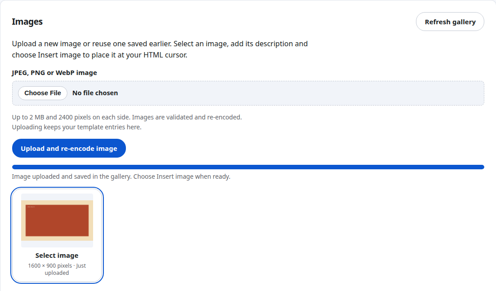

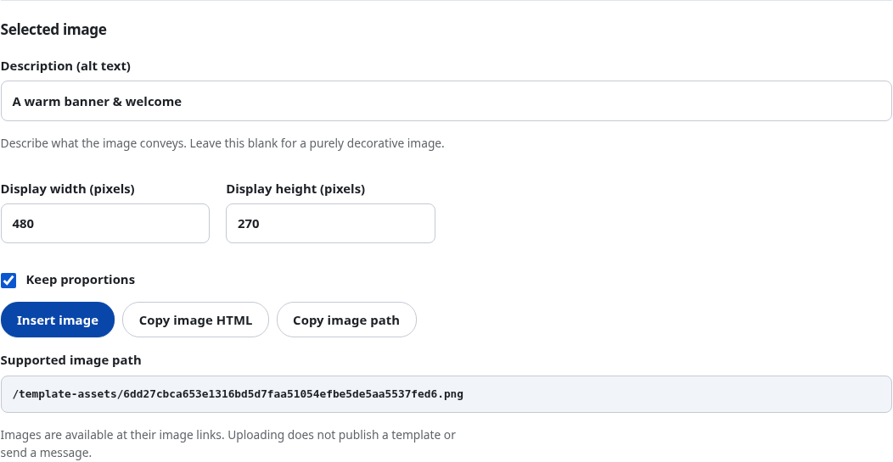

Images must be at most 2 MB and 2400 pixels on each side. Emailer validates and re-encodes them. SVG and other unsupported files are rejected with an explanation. On failure, your entries stay here; correct the file and use Retry upload. If a connection fails after upload started, refresh the gallery before retrying because the image may already have been saved. Cancel also does not remove an image that already reached the server.

Saved image links can be opened without signing in so recipients can see them. Upload only images that are safe to share. The editor uses a relative /template-assets/ image reference; delivered messages automatically use your installation’s HTTPS address. Keep that address and HTTPS working while recipients use those images.

### Recover unsaved work

The editor keeps an unsaved recovery copy in this browser tab for up to 12 hours. After refresh or returning, choose Restore draft to bring back the five fields and HTML cursor, or Discard recovered draft to use the saved version. Each tab has its own copy. Use Save template draft for durable storage; closing the tab may remove browser recovery. Close the tab when finished on a shared computer.

If browser storage is unavailable, the editor says so and warns before you leave with unsaved changes. Keep a copy of your content or save it before leaving. If saving fails validation, your submitted fields remain visible with the error; correct them and save again. Insertion errors leave the HTML unchanged. Uploading, recovering and saving a draft send no messages.

### Placeholders and importing HTML

The Supported placeholders panel beside the editor lists every available placeholder, a sample result and an Insert button. Put the cursor in Subject, Preheader, HTML or Plain text, then choose Insert. The Insert into selector lets you choose the destination explicitly. For example, `{{ recipient.first_name }}` becomes the reader's first name. URL placeholders insert a complete link in HTML, or the URL placeholder itself in Plain text; they cannot be used in Subject or Preheader.

To bring in an existing HTML file, use Import HTML in Templates. The file must be UTF-8 and at most 200 KB. Confirm replacement if HTML is already entered. Importing does not replace the name, subject, preheader or plain text, and does not save or publish anything.

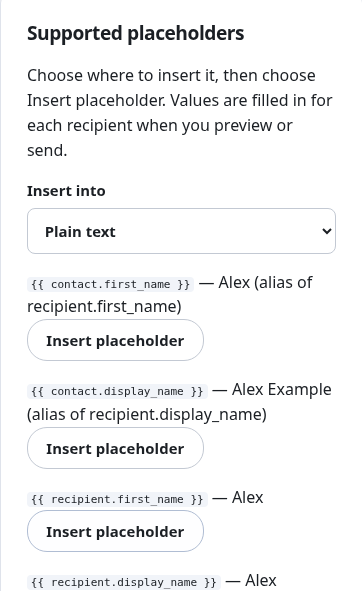

If saving fails, the message names the input field, line and exact offending placeholder, then gives a correction. For example, Subject, line 1, `{{ first_name }}`: use `{{ recipient.first_name }}`. Your five fields remain entered; correct the indicated text and choose Save template draft again. Older `{{name}}` and `{{email}}` forms are unsupported.

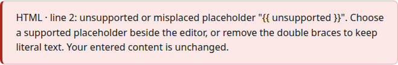

Save template draft stores an unpublished version. Preview it and choose Publish separately when the content is ready for campaign tests and review. Saving, importing HTML and uploading images do not publish a template, approve a campaign or send email. A new template version never silently replaces an existing campaign's chosen version.

## Health, backups and updates

Doctor shows each sending blocker and repair action. Native updates and edition upgrades also leave an operational hold. Use the installer's explicit Resume action after readiness passes. Previously approved due campaigns may continue when you resume; drafts are never approved automatically.

Fresh setup enables daily encrypted local backup copies. Under Backups inspect verification and transfer evidence, adjust policy or create and verify an on-demand backup. Keep the recovery-key package and its password separately. Same-server copies do not protect against server loss; arrange an independent backup destination. Restore drills are supervised, never automatic.

For Ripe 1.0.6, 1.1.0, 1.2.1, 1.2.2, 1.3.0, 1.3.1 or 1.3.2 to 1.3.3, start the new official setup file, choose Update with a verified backup and follow any Finish instruction. This includes Ripe 1.1.0 installations previously converted from Light. Existing MFA, password, recipients, tracking, SMTP encryption contexts and recovery history are retained. Review Doctor before Resume. Earlier Ripe versions must follow their published supported path to 1.0.6 first. Interrupted operations use Recover; committed operations use Finish and cannot be downgraded by recovery. See the [operator reference](emailer-ripe-operator.md).

This release adds a database migration. Update with the guided setup file and keep its recovery material. Normal restore needs the same database schema. Recover older backups with their matching release in an isolated environment. For interrupted updates choose Recover in setup; a completed update cannot be downgraded through recovery.
