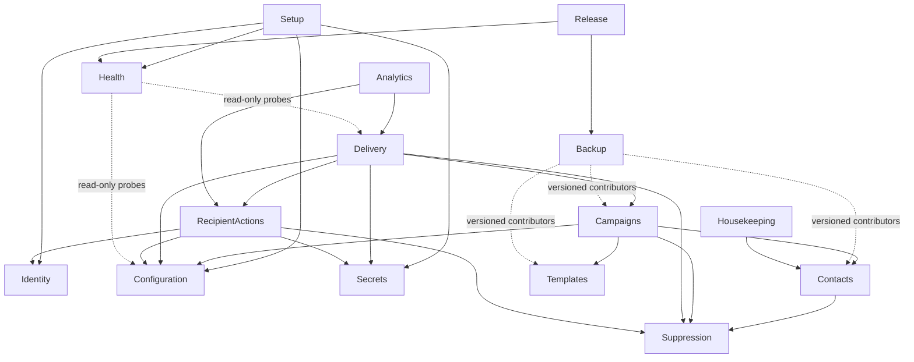

# Module boundaries and dependency rules

**Status:** Phase 9 accepted rules with executable enforcement; no module boundary changed in Phase 9.

The application is a modular monolith. A module owns its rules, tables,
repositories, application services, and presentation adapters. Ownership is a
code-review boundary even though all modules deploy in one process.

## Required modules

| Module | Owns | May consume |
| --- | --- | --- |
| `Setup` | Setup-mode state, ownership challenge, install lock, wizard orchestration | Narrow contracts from Configuration, Secrets, Identity, Health, and Audit |
| `Identity` | Users, roles, MFA, recovery, sessions, re-authentication | Shared audit and clock contracts |
| `Configuration` | Organisation settings, delivery/privacy limits, sender identities, non-secret transport metadata | Secrets references and shared audit contract |
| `Secrets` | Key derivation, ciphertext envelopes, secret inventory and rotation | Installation identity and external key-file adapter |
| `Contacts` | Contacts, attributes, lists, memberships, import/export workflow | Suppression query contract |
| `Templates` | Templates, immutable versions, merge schema, sanitisation policy, safe assets | Configuration display defaults |
| `Campaigns` | Campaign state machine, audience snapshots, approvals, scheduling | Read contracts from Contacts, Templates, Configuration, and Suppression |
| `Delivery` | Delivery ledger, dispatch, retries, worker, transport and rate limits | Approved Campaign snapshot, Suppression, Configuration, Secrets, and RecipientActions link contracts |
| `Suppression` | Global suppression records and idempotent decisions | Shared audit contract |
| `RecipientActions` | Opaque public tokens and unsubscribe commands (later view-in-browser/RSVP) | Suppression command, Configuration runtime identity/origin, Secrets vault, and Identity authorization contracts |
| `Analytics` | Approximate open/click events and redacted reporting projections | Redacted events from Delivery and RecipientActions |
| `Audit` | Append-only audit event persistence and redacted reads | No business-module internals |
| `Health` | Doctor probes, findings, heartbeats, sending-gate projection | Read-only health contracts; never direct mutation of business state |
| `Backup` | Backup records, manifests, encryption/export and restore orchestration | Versioned backup contributor contracts from data-owning modules |
| `Release` | Artifact metadata, version compatibility, update/rollback checks | Health and migration status contracts |
| `Housekeeping` | Bounded dry-run/apply retention and run evidence | Primitive storage contracts owned by affected modules |

## Dependency rules

1. A module may depend only on another module's published `Application/Contract`
   types. It may not import that module's `Domain`, `Infrastructure`, or
   `Presentation` namespace.
2. A module may not query or write another module's tables. Cross-module
   consistency is coordinated by an application service and explicit
   transaction, or by an idempotent event handler when immediate consistency is
   unnecessary.
3. Doctrine entities never cross a module boundary. Contracts carry opaque IDs,
   immutable value objects, counts, or explicitly classified redacted data.
4. Controllers and commands call one application use case. They do not compose
   repositories or embed business transitions.
5. Domain code has no Symfony, Doctrine, Twig, filesystem, network, clock, or
   random-number dependency. These arrive through narrow ports.
6. All modules may emit audit events through a shared interface, but only
   `Audit` persists or queries the audit store.
7. `Health` observes safe probe results and derives gates. It cannot repair,
   rotate, migrate, send, or delete automatically.
8. `Backup` uses registered, versioned contributors. It does not infer tables
   or filesystem paths owned by another module.
9. Public token verification is centralized in `RecipientActions`; other
   modules cannot invent token formats.
10. Shared code is limited to stable technical primitives: identifiers, clock,
    transaction boundary, redacted domain-event envelope, and authorization
    context. Shared business models are prohibited.

## Dependency direction

Audit emission is omitted from the diagram because every mutating module uses
the same narrow audit sink. Cycles shown by future static analysis are a design
failure unless an ADR explicitly replaces the contracts involved.

## Enforcement

Phase 1 added `deptrac.yaml` plus
`tools/quality/check-module-boundaries.php`; both run under
`composer check`. The current checks reject:

- imports across forbidden namespaces;
- controllers using repositories directly;
- domain namespaces importing framework or persistence classes;
- a column or symbol named `tenant_id`, `tenantId`, or an equivalent
  cross-organisation discriminator.

Deptrac currently sees the implemented `Health` Presentation adapter and shared
Infrastructure adapters; zero dependency violations are allowed. The custom
check examines all project PHP files even when a future namespace is not yet
represented in Deptrac's graph. Each later phase must extend fixtures/rules for
its modules, including identifier-only queue-message shape once messages exist.

Exceptions require a reviewed ADR and updated threat model; a PHPStan ignore or
baseline entry alone is not an exception.

Phase 3 implements narrow contracts for `Setup` orchestration to consume
`Configuration`, `Identity`, `Secrets`, and `Health` behavior. DBAL adapters
remain in the owning module; cross-module imports target only
`Application\Contract`. The completion event remains Setup-owned and fixed in
shape so Phase 3 does not introduce the general Phase 4 Audit module.

Phase 5 implements `Contacts`, `Suppression`, and `Templates`. Contacts consumes
only the suppression lookup contract; filesystem import and asset stores
implement application-owned primitive contracts. Controllers call application
services. Shared conservative email handling and UUIDv7/UTC generation are
stable technical primitives under `App\Shared`; the static gates report no
cross-layer or cross-module violation.
