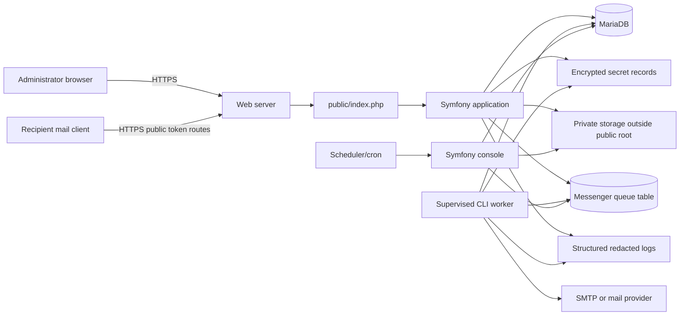

# Emailer Next — Master Product and Engineering Specification

**Status:** Approved development baseline  
**Product model:** One installation, one organisation, one server  
**Development workspace name:** `emailer-next`  
**Intended final repository:** `Attory/emailer-next` after the compromised repository is deleted  
**Clean-room rule:** The legacy Emailer repository is reference-only. No source file, Git object, dependency bundle, template, secret, private record, or executable code may be copied from it.

---

## 1. Executive summary

Emailer Next is a secure, self-hosted email campaign application installed independently on each client’s server. Every installation serves exactly one organisation. It may have several administrative users, but it is **not multi-tenant**, has no tenant switching, and must not add `tenant_id` or equivalent cross-client architecture.

The application replaces the legacy Emailer with a clean implementation. It keeps the useful product behaviour—recipient imports, templates, campaign creation, queued delivery, progress reporting, suppression/unsubscribe handling, optional tracking, and optional RSVP/response flows—but does not reuse the legacy implementation.

Security, recoverability, and operator clarity are first-class product features. The application must fail closed, keep secrets and private data outside the public document root, use a durable transactional database, run mail delivery only through a supervised command-line worker, and continuously report configuration risks through a Configuration Doctor.

---

## 2. Non-negotiable clean-room constraints

1. Create the new project in a new directory and a new Git history.
2. Do not clone, import, add as a remote, copy, vendor, or inspect the legacy Emailer repository during implementation.
3. Do not use the temporary source repository as a source, submodule, package, or reference remote.
4. Do not copy legacy PHP, HTML, JavaScript, CSS, templates, PHPMailer files, queue files, logs, backups, CSV files, recipient data, or `.git` objects.
5. Product behaviour may be recreated only from this written specification and operator-approved screenshots or descriptions that contain no secrets or personal data.
6. No real SMTP credential, administrator password, recipient address, private template, production URL token, private key, or recovery key may enter:
   - Git;
   - Codex prompts;
   - Mitek/Hermes chat;
   - CI variables printed in logs;
   - fixtures;
   - screenshots;
   - test snapshots.
7. The first commit must contain only documentation, safe configuration examples, and/or a framework-generated skeleton.
8. Test environments must be unable to contact live SMTP by default.
9. Any secret or private-data finding in the working tree, Git history, build artifact, fixture set, or generated log blocks release.
10. The old application may remain available only as an operator-controlled external reference while credentials are rotated and containment is completed. It must never become part of the new repository.

---

## 3. Product scope

### 3.1 In scope for version 1

- Secure first-run web onboarding with filesystem ownership proof.
- CLI installation alternative.
- One organisation per installation.
- Multiple individual administrator accounts.
- Role-based access: Owner, Administrator, Operator, Auditor.
- Secure login, session management, CSRF protection, throttling, password reset, optional TOTP MFA, recovery codes, and re-authentication for sensitive operations.
- One primary mail transport per installation, using SMTP or a supported Symfony Mailer provider adapter.
- Sender identity configuration and test delivery.
- Contact and list management.
- Streaming CSV import with mapping, validation, deduplication, preview, limits, and rejection report.
- Global suppression list.
- Versioned email templates with safe merge fields.
- Campaign drafts, previews, test sends, scheduling, approval, queueing, pause, resume, cancel, and progress.
- Durable background delivery worker with bounded retries, dead-letter state, rate limiting, health heartbeat, and recovery.
- One message per recipient; never bulk-BCC recipients.
- Standards-compatible unsubscribe flow, including RFC 8058 one-click unsubscribe where enabled.
- Optional open tracking and click tracking, disabled by default.
- Optional signed RSVP/response form module.
- Dashboard and redacted operational reporting.
- Append-only application audit events.
- Configuration Doctor on admin login, scheduled daily, and on demand.
- Backup, restore, retention, deployment, upgrade, and rollback tooling.
- CI, tests, static analysis, dependency audit, secret scanning, private-data scanning, and release-artifact inspection.
- Apache and Nginx deployment examples.
- Recommended long-running worker mode plus a constrained cron fallback for hosting without systemd/Supervisor.

### 3.2 Explicitly out of scope for version 1

- Multi-tenancy or multiple organisations in one installation.
- Self-registration by public users.
- Public campaign-creation API.
- Arbitrary plugin execution.
- Arbitrary PHP or JavaScript in templates.
- Importing legacy Git history.
- Automatic credential rotation at third-party providers.
- Automatic DNS modification.
- Claims of exactly-once SMTP delivery.
- Unattended automatic application upgrades.
- Storing SMTP credentials in Git, `.env` committed files, source code, browser local storage, logs, or queue payloads.
- Shared global administrator password.
- Publicly callable send, queue, template-delete, backup, restore, or configuration endpoints.

---

## 4. Selected technical baseline

### 4.1 Runtime and framework

- PHP **8.4 or newer supported stable branch**.
- Symfony **7.4 LTS**, pinned to a supported patch release.
- Composer 2 with committed `composer.lock`.
- Required PHP extensions:
  - `ctype`
  - `curl`
  - `filter`
  - `hash`
  - `intl`
  - `json`
  - `mbstring`
  - `openssl`
  - `pdo`
  - `pdo_mysql`
  - `sodium`
  - `session`
  - `zip`
- Server-rendered Twig UI.
- Symfony AssetMapper and Stimulus for small progressive enhancements.
- No Node.js requirement in production.
- No SPA for version 1.

### 4.2 Application components

- Symfony Security for authentication and authorization.
- Doctrine ORM/DBAL and Doctrine Migrations.
- MariaDB 10.11+ as the initial production database target.
- Symfony Mailer and Mime.
- Symfony Messenger with Doctrine transport for the initial queue backend.
- Monolog with structured JSON production logs and strict redaction.
- Symfony RateLimiter.
- Symfony Validator.
- Symfony Lock where cross-process locking is required.
- PHPUnit for tests.
- PHPStan at the highest practical strictness, with no unreviewed baseline growth.
- A coding-standard tool and automatic formatter.
- Mailpit or equivalent local fake SMTP in development and CI.
- Docker Compose for a reproducible development environment; Docker is not required for production.

### 4.3 Architectural style

Use a modular monolith with explicit bounded modules. This avoids unnecessary distributed-system complexity while keeping boundaries clear enough for future replacement or extraction.

Required modules:

1. `Setup`
2. `Identity`
3. `Configuration`
4. `Secrets`
5. `Contacts`
6. `Templates`
7. `Campaigns`
8. `Delivery`
9. `Suppression`
10. `RecipientActions`
11. `Analytics`
12. `Audit`
13. `Health`
14. `Backup`
15. `Release`

Business rules must live in application/domain services, not controllers, Twig templates, Doctrine entities, console commands, or JavaScript.

---

## 5. Runtime topology



Only `public/` is served by the web server. The project root, `.git`, configuration, dependencies, logs, queue data, backups, and secret key files must not be web-accessible.

---

## 6. Required filesystem layout

```text
emailer-next/
├── assets/
├── bin/
│   └── console
├── config/
├── migrations/
├── public/
│   ├── index.php
│   └── build-or-asset-files/
├── src/
│   └── Module/
├── templates/
├── tests/
├── translations/
├── var/
│   ├── cache/
│   ├── log/
│   ├── private/
│   │   ├── uploads/
│   │   ├── exports/
│   │   ├── backups/
│   │   └── setup/
│   └── secrets/
│       └── master.key
├── vendor/
├── .emailer-install-proof       # exists only during first-run proof
├── .env                         # local runtime values; never committed
├── .env.example                 # placeholders only
├── composer.json
└── composer.lock
```

Production may point private and secret directories to paths outside the release directory:

```text
EMAILER_PRIVATE_DIR=/srv/emailer-data
EMAILER_SECRET_KEY_FILE=/etc/emailer/master.key
```

The application must refuse production operation when:

- the web server document root is not `public/`;
- the secret key is inside `public/`;
- a private directory is inside `public/`;
- the secret key or private directory is group/world writable;
- debug mode is enabled;
- required migrations are pending;
- the installation lock is missing after setup.

---

## 7. First-run onboarding and ownership verification

### 7.1 Setup-mode state

A fresh installation has no installation lock. In this state:

- normal admin and campaign routes return a setup-required response;
- no send operation can run;
- the worker refuses to deliver;
- only minimal setup routes and a non-sensitive health response are available;
- setup pages must never display environment values, stack traces, paths containing usernames beyond the one exact proof path, or secret material.

### 7.2 Ownership challenge

On the first setup request:

1. Generate a 160-bit random value using `random_bytes()`.
2. Encode it using uppercase Crockford Base32 and display it in grouped form for readability.
3. Create a random challenge identifier.
4. Store only:
   - challenge identifier;
   - SHA-256 hash of the normalized code;
   - creation time;
   - expiry time;
   - failed-attempt count;
   - requesting IP hash;
   in `var/private/setup/challenge.json`.
5. Store the state file with mode `0600`.
6. Display the exact fixed proof path:

```text
<APPLICATION_ROOT>/.emailer-install-proof
```

7. Tell the administrator to create that file and put only the displayed code inside it.

The challenge:

- expires after 15 minutes;
- is single-use;
- permits at most 10 verification attempts;
- is rate-limited;
- is rotated after expiry or excessive failures;
- is never accepted from a query string or request body as proof;
- must be read only from the fixed filesystem path.

### 7.3 Proof-file validation

The verifier must:

- use `lstat()` and reject symlinks;
- require a regular file;
- reject files larger than 256 bytes;
- reject group/world-writable files;
- trim only documented line-ending whitespace;
- compare the code using `hash_equals()`;
- avoid returning different public errors for missing versus incorrect content;
- log only the challenge ID and result, never the code;
- delete the proof file and challenge state after success;
- rotate the setup session identifier after success.

Filesystem proof establishes control of the deployment directory. It does not substitute for HTTPS or the initial Owner account.

### 7.4 HTTPS gate

The ownership-code page may explain TLS requirements over HTTP, but the application must not accept:

- the initial Owner password;
- SMTP credentials;
- recovery material;
- backup passphrases;
- MFA secrets;

unless the request is HTTPS and trusted-proxy handling is correctly configured.

After filesystem proof, if HTTPS is unavailable, the wizard stops with exact server-configuration guidance. A CLI installer remains available.

### 7.5 Wizard sequence

The wizard must be resumable without storing plaintext secrets in setup state.

1. **System preflight**
   - PHP version and extensions.
   - `public/` document-root verification.
   - private and secret directory permissions.
   - database driver availability.
   - HTTPS and proxy configuration.
   - writable cache/private directories.
   - scheduler/worker capability detection.

2. **Database**
   - Host, port, database, username, password.
   - Test connection before continuing.
   - Store database password using server runtime configuration, not in the application database.
   - Run migrations transactionally where supported.
   - Never print the DSN.

3. **Installation keys**
   - Generate a 32-byte master key.
   - Write it to the configured secret-key file with mode `0600`.
   - Generate a random installation UUID.
   - Derive purpose-specific subkeys using HKDF with explicit context labels.

4. **Organisation**
   - Organisation display name.
   - Base URL.
   - Time zone.
   - Default locale.

5. **Initial Owner**
   - Individual email/username.
   - Strong password.
   - Password confirmation.
   - Optional TOTP enrolment, strongly recommended.
   - Generate single-use recovery codes and display them once.
   - Require explicit acknowledgement that recovery codes were saved.

6. **Mail transport**
   - SMTP/provider type.
   - Host, port, encryption mode.
   - Username and password/API key.
   - Sender address, sender name, optional reply-to.
   - TLS peer verification always enabled in production.
   - Test connection and test message.
   - Store credentials only after the master key exists.
   - Never redisplay the secret.

7. **Delivery limits**
   - Maximum messages per minute.
   - Worker concurrency.
   - Retry policy within safe system bounds.
   - Maximum campaign size.
   - Maximum CSV size and row count.

8. **Privacy defaults**
   - Open tracking off by default.
   - Click tracking off by default.
   - RSVP module off by default.
   - Retention periods.
   - Suppression behaviour.
   - Default unsubscribe footer.

9. **Worker and scheduler**
   - Detect recommended long-running worker support.
   - Generate systemd/Supervisor examples.
   - Offer cron fallback.
   - Verify heartbeat before setup completion, or record a critical Doctor finding.

10. **Final Doctor**
    - Run all critical checks.
    - Block completion if a critical security condition fails.
    - Write `var/private/install.lock` containing only non-secret metadata.
    - Disable setup routes; subsequent setup requests return 404.
    - Create the first append-only audit event.

### 7.6 Reset and recovery

- Setup cannot be reopened with a URL parameter, deleted cookie, or database edit.
- Reset is CLI-only:
  - `bin/console emailer:setup:reset`
- Reset requires interactive confirmation and a recent backup.
- Reset must refuse when production data exists unless an explicit destructive flag is used.
- Reset never prints or exports existing secrets.

---

## 8. Secrets and cryptography

### 8.1 Master key

- Generate with `random_bytes(32)`.
- Store outside `public/`, preferably outside the release directory.
- File mode `0600`; parent directory `0700`.
- Never store the key in the database, Git, logs, browser storage, session data, or queue payload.
- The application must fail closed if the key is missing, malformed, or too permissive.

### 8.2 Dynamic secret records

SMTP passwords, provider API keys, webhook signing secrets, TOTP seeds, and similar reversible values must be encrypted before database storage.

Use:

- libsodium XChaCha20-Poly1305 authenticated encryption;
- a fresh nonce for every encryption;
- purpose-specific derived key;
- associated data containing installation UUID, record type, record ID, and schema version;
- versioned ciphertext envelope;
- constant-time authentication failure handling.

Password credentials for application users are never encrypted. They are hashed with Argon2id using framework-supported adaptive settings.

### 8.3 Secret lifecycle

Provide:

- redacted secret inventory;
- creation and last-rotation timestamps;
- replace/rotate workflow requiring Owner re-authentication;
- `bin/console emailer:secrets:rotate-master-key`;
- transactional re-encryption;
- rollback on any failure;
- audit events without secret values;
- documented recovery procedure.

### 8.4 Backing up the master key

The normal application backup excludes the plaintext master key. Provide a separate recovery-key export command that encrypts the key package using an operator-provided strong passphrase. The passphrase is never stored.

The Doctor must warn when no verified recovery package has been recorded.

---

## 9. Identity, roles, and sessions

### 9.1 Account model

Every administrator has an individual account. Shared accounts are prohibited.

Roles:

- **Owner**
  - Full access.
  - Secrets and recovery management.
  - User and role management.
  - Upgrade and restore approval.
  - At least one active Owner must always remain.

- **Administrator**
  - Configuration except master-key recovery.
  - Users except Owner removal or promotion.
  - Templates, contacts, campaigns, and reports.

- **Operator**
  - Contacts, templates, campaign drafting, test sends, scheduling, pause/resume/cancel.
  - Cannot change SMTP credentials, roles, backups, retention, or security settings.

- **Auditor**
  - Read-only access to reports, campaign history, health results, and redacted audit events.

### 9.2 Authentication controls

- Argon2id password hashing.
- Password length and breach-resistant policy; allow password managers and paste.
- Generic login and recovery responses.
- Login throttling by account and source.
- Progressive delay and temporary lock, without permanent denial-of-service.
- Optional TOTP MFA in version 1.
- Recovery codes stored as hashes and consumed once.
- MFA required for Owners before production release is marked healthy, unless an operator-approved policy exception is recorded and shown as a warning.
- Password-reset links are random, single-use, short-lived, hashed at rest, and invalidate existing sessions after completion.

### 9.3 Sessions

- Server-side session storage in the database.
- Session IDs generated by the framework.
- Rotate ID on login, logout, privilege change, password change, MFA change, and re-authentication.
- Cookies:
  - `Secure`
  - `HttpOnly`
  - `SameSite=Lax` or stricter after explicit compatibility testing
  - narrow path and host scope
- Idle and absolute expiration.
- Per-user session list and revocation.
- Logout invalidates the server-side session.
- Trusted proxies configured explicitly; never trust arbitrary forwarded headers.

### 9.4 Authorization and CSRF

- Deny by default.
- Central route-level and service-level authorization.
- Every state-changing browser action uses POST/PUT/PATCH/DELETE and CSRF protection.
- GET and HEAD are safe and side-effect free.
- Sensitive changes require recent re-authentication.
- Route-by-role authorization matrix is generated and tested.
- Public token routes use dedicated purpose-scoped authorization and do not share admin sessions.

---

## 10. Data model

All primary identifiers exposed outside the database are UUIDv7 or cryptographically random opaque identifiers. Avoid predictable numeric IDs in URLs.

Required conceptual entities:

- `User`
- `MfaCredential`
- `UserSession`
- `OrganisationSettings`
- `EncryptedSecret`
- `SenderIdentity`
- `Contact`
- `ContactAttribute`
- `ContactList`
- `ListMembership`
- `Suppression`
- `Template`
- `TemplateVersion`
- `Campaign`
- `CampaignAudienceSnapshot`
- `CampaignRecipient`
- `DeliveryAttempt`
- `RecipientToken`
- `TrackingEvent`
- `AuditEvent`
- `HealthCheckResult`
- `BackupRecord`

### 10.1 Data minimisation

- Store only fields required for sending and approved reporting.
- Keep raw recipient addresses out of URLs, log messages, exception text, queue names, filenames, metrics labels, and correlation IDs.
- Display masked addresses in ordinary operational views.
- Full recipient addresses require a role check and are never included in exported diagnostics.
- Retention jobs remove analytics and transient delivery data according to policy.
- Suppression records are durable and retained independently of ordinary analytics unless law/policy requires otherwise.

---

## 11. Contacts and list management

### 11.1 Contact records

Minimum fields:

- email address;
- display name / first name / last name;
- locale;
- time zone;
- status;
- consent/source metadata;
- created/updated timestamps;
- custom fields stored under an approved schema.

Email addresses must be normalized conservatively. Do not alter local-part case or provider-specific dots/plus addressing. Use a canonical comparison value while retaining the entered value where policy allows.

### 11.2 CSV import

- Streaming parser; memory usage must remain bounded.
- UTF-8 with BOM support.
- Explicit headered and headerless modes.
- Column-mapping preview.
- Maximum upload size, row count, field size, and column count.
- Reject formulas when exporting CSV.
- Validate email syntax, required fields, encodings, control characters, and lengths.
- Deduplicate within the file and against the selected list.
- Show counts before commit:
  - valid;
  - duplicate;
  - suppressed;
  - invalid;
  - rejected.
- Produce a private rejection report with row number and safe reason, not a public file.
- Uploaded files are temporary, outside `public/`, with random names and automatic deletion.
- No symlink following or path input from the browser.

### 11.3 Lists and suppression

- Contacts may belong to multiple lists.
- Suppression is global by default.
- Every send path checks suppression immediately before delivery.
- Suppression updates are idempotent.
- Owner-approved import/export tools must preserve suppression status.
- No feature may “temporarily ignore” suppression.

---

## 12. Templates

### 12.1 Template model

- Template metadata and immutable versions.
- Draft and published states.
- Subject, preheader, HTML body, plain-text body.
- Safe merge fields, such as:
  - `{{ contact.first_name }}`
  - `{{ contact.display_name }}`
  - `{{ campaign.name }}`
  - `{{ unsubscribe_url }}`
  - `{{ view_in_browser_url }}`
  - optional `{{ rsvp_url }}`
- Unknown required merge fields block publication.
- Every campaign snapshots the template version used.

### 12.2 Content safety

- Templates cannot contain PHP, server-side Twig expressions beyond the allowlisted merge language, JavaScript, forms, iframes, embedded credentials, or arbitrary remote script.
- Sanitize HTML using an allowlist.
- Encode merge values according to HTML, text, header, and URL context.
- Validate links.
- Prevent header injection.
- Generate a plain-text alternative.
- Uploaded images:
  - JPEG, PNG, and WebP only in version 1;
  - no SVG;
  - MIME detected from content;
  - size and dimension limits;
  - random filename;
  - stripped metadata where practical;
  - stored in a dedicated public asset area with no execute permission.
- A template preview uses synthetic data only.
- Test sends are visibly marked and do not affect campaign analytics.

### 12.3 Template lifecycle

- Create, clone, edit, preview, test, publish, archive.
- Delete means archive when referenced by a campaign.
- Permanent deletion requires Owner authorization and is impossible when retention rules require preservation.
- No public template-delete endpoint.

---

## 13. Campaigns

### 13.1 Campaign lifecycle

```text
draft
  -> ready_for_review
  -> approved
  -> scheduled
  -> queueing
  -> sending
  -> paused
  -> completed
  -> cancelled
  -> failed
```

Only valid transitions are accepted.

### 13.2 Campaign construction

- Select one published template version.
- Select one or more lists or a saved segment.
- Snapshot the audience at approval/queue time.
- Re-check suppression immediately before send.
- Show recipient counts, exclusions, and estimated duration.
- Require a test send before approval unless explicitly waived by an Administrator.
- Require a typed confirmation for production queueing.
- Support immediate or scheduled sending.
- Use the installation time zone but store timestamps in UTC.
- Do not silently reuse a previous template, audience, or configuration.

### 13.3 Pause, resume, and cancel

- Pause prevents new delivery claims; in-flight attempts may finish.
- Resume continues only eligible pending/retry deliveries.
- Cancel marks unclaimed deliveries cancelled and does not retract accepted email.
- All operations are idempotent and audited.
- Campaign state never depends on a browser session remaining open.

---

## 14. Queue and delivery architecture

### 14.1 Durable job model

Use Symfony Messenger with Doctrine transport initially. Create delivery records before dispatch.

Each campaign recipient has a unique delivery ledger row with:

- campaign ID;
- contact ID;
- template snapshot ID;
- deterministic message ID;
- state;
- attempt count;
- next-attempt time;
- last classified error;
- accepted timestamp;
- provider message identifier when available.

A unique database constraint prevents duplicate campaign-recipient ledger rows.

### 14.2 Delivery semantics

The system provides **at-least-once processing** and best-effort duplicate minimisation. It must not claim exactly-once SMTP delivery.

Controls:

- deterministic `Message-ID`;
- ledger checked before every attempt;
- provider idempotency key where supported;
- state transition transaction;
- bounded retries;
- duplicate-risk audit event after ambiguous SMTP outcomes;
- operator-visible ambiguous state rather than automatically claiming success.

### 14.3 Worker

- CLI-only Symfony Messenger worker.
- Cannot be invoked through HTTP.
- Recommended deployment: systemd or Supervisor.
- Cron fallback processes a bounded amount of work and exits cleanly.
- Heartbeat stored at a fixed interval.
- Graceful SIGTERM.
- Memory and time limits.
- Worker restart policy.
- Dead-letter/failure queue.
- Retry classification:
  - transient;
  - permanent;
  - ambiguous;
  - suppressed/cancelled.
- Exponential backoff with jitter and configurable cap.
- Global and per-domain rate limits.
- Configurable concurrency.
- Circuit breaker after repeated transport failures.
- No credential values in serialized messages.

### 14.4 Progress

Dashboard counts derive from the delivery ledger, not from browser-side counters:

- pending;
- processing;
- accepted;
- retried;
- permanently failed;
- ambiguous;
- suppressed;
- cancelled.

“Sent” means accepted by the configured transport, not delivered to the inbox.

---

## 15. Mail transport and deliverability

### 15.1 Mail configuration

- Symfony Mailer transport adapter.
- SMTP TLS peer verification mandatory in production.
- STARTTLS or implicit TLS according to provider.
- No option in the web UI to disable TLS verification.
- Configurable connection/send timeout within safe bounds.
- Sender address validation.
- Test connection and test message.
- Support one active primary transport in version 1.
- Design adapter boundary for future provider API transports and failover.

### 15.2 Message construction

- One message per recipient.
- No bulk BCC.
- Unique opaque recipient token.
- HTML and text parts.
- Correct Date, Message-ID, From, Reply-To, and return-path/envelope configuration.
- `List-Unsubscribe` and `List-Unsubscribe-Post` when one-click unsubscribe is enabled and provider/domain signing supports it.
- No raw email address in tracking or unsubscribe URLs.
- No secret or internal path in headers.
- Test mode rewrites recipients to the approved test address and adds an unmistakable subject prefix.

### 15.3 DNS and provider checks

Configuration Doctor may query and report:

- SPF presence;
- DKIM selector record when configured;
- DMARC presence and policy;
- MX and hostname resolution;
- reverse-DNS guidance where relevant.

The app does not modify DNS and does not claim that a record is semantically correct merely because it exists.

---

## 16. Unsubscribe, recipient actions, and tracking

### 16.1 Token design

Public recipient links use opaque purpose-scoped tokens with:

- random identifier or authenticated encrypted payload;
- campaign/list scope;
- recipient scope;
- purpose;
- issuance time;
- expiry policy;
- key version.

Tokens never include raw email addresses. Token verification is constant-time and rejects wrong purpose, tampering, and unsupported key versions.

### 16.2 Unsubscribe

- Manual GET shows a minimal confirmation/status page.
- One-click POST follows RFC 8058.
- No redirect for the one-click POST.
- No login or cookie required.
- Repeated requests are idempotent.
- Global suppression is applied immediately.
- The response does not disclose whether arbitrary addresses exist.
- Rate limiting protects abuse without blocking legitimate one-click requests.
- Every sender checks suppression before delivery.
- Key rotation supports an overlap window.

### 16.3 Open and click tracking

- Disabled by default.
- Each feature is independently configurable.
- Tracking uses opaque identifiers.
- No raw recipient identity in request paths, query strings, logs, or analytics labels.
- Open events are presented as approximate.
- Click redirects use an allowlisted target captured at template publication; no open redirect.
- Public event endpoints set no admin session cookie.
- Tracking retention is configurable and enforced.
- Disabling tracking removes generated pixels and redirect URLs from future messages.

### 16.4 RSVP/response module

Optional version-1 module:

- explicitly enabled per installation and campaign;
- signed opaque recipient link;
- allowlisted form schema;
- bounded fields and sizes;
- CSRF is not based on admin sessions; token purpose authorizes the recipient action;
- repeat submissions follow configured policy;
- no raw PII in logs;
- private storage and retention;
- exports require authorization and spreadsheet-formula neutralisation.

---

## 17. Configuration Doctor

### 17.1 User experience

- A lightweight cached Doctor runs after every admin login.
- A full Doctor runs daily and on demand.
- Status levels:
  - green: healthy;
  - amber: warning;
  - red: critical.
- A persistent banner appears for critical findings.
- Findings include:
  - human explanation;
  - risk;
  - evidence without secrets;
  - exact remediation;
  - whether sending is blocked;
  - first/last observed timestamps.
- Redacted report export contains no credentials or recipient data.

### 17.2 Required checks

#### Installation and web boundary

- Setup routes are disabled.
- Installation lock exists.
- Document root is `public/`.
- `.git`, `.env`, backups, logs, JSON data, private files, and secret paths are not web-accessible.
- Debug mode and profiler are disabled.
- HTTPS is active.
- Trusted proxies are explicit.
- HSTS and approved security headers are present after HTTPS is confirmed.
- CSP has no unsafe wildcard/script configuration without an approved exception.

#### Filesystem and secrets

- Secret key exists and has safe permissions.
- Private directories are outside `public/`.
- Writable directories are not world writable.
- Master-key recovery package status.
- No likely secret in tracked files or release artifact.
- No likely PII fixture or generated log in tracked files.

#### Database

- Connectivity.
- Migrations current.
- Required constraints and indexes.
- Database server version supported.
- Backup age and last restore drill.
- Suppression-table integrity.

#### Identity

- At least one active Owner.
- No shared/default account.
- Owner MFA status.
- Recent brute-force/lockout events.
- Session-cookie attributes.
- Password hasher configuration.
- Stale privileged sessions.

#### Mail and delivery

- Transport decrypts and connects.
- TLS verification.
- Sender identity.
- Optional test-mail status.
- Worker heartbeat.
- Scheduler heartbeat.
- Queue age, failed/dead-letter count, and stuck processing records.
- Disk capacity.
- Provider rate settings.
- SPF/DKIM/DMARC observations.

#### Application and release

- Supported PHP and Symfony versions.
- Dependency audit.
- Debug/test packages absent from production artifact where required.
- Release signature/checksum status.
- Pending update or end-of-support warning.
- Retention jobs running.
- Log rotation functioning.

### 17.3 Sending gates

Block new production campaign sends when any of these are critical:

- setup is unlocked or reopened;
- HTTPS is absent;
- secret key unavailable or permissions unsafe;
- private/public boundary invalid;
- database migration pending;
- suppression store unavailable;
- transport cannot authenticate/decrypt configuration;
- worker/scheduler unavailable for the selected deployment mode;
- release artifact contains a likely credential or private key;
- application is in debug/test mode.

Existing in-flight delivery handling must follow a documented safe policy rather than abruptly corrupting state.

---

## 18. Logging and audit

### 18.1 Operational logs

- Structured JSON in production.
- UTC timestamps.
- Correlation IDs are random and non-secret.
- No SMTP passwords, API keys, session IDs, CSRF values, MFA seeds, recovery codes, full recipient lists, message bodies, uploaded CSV rows, or raw tokens.
- Email addresses are omitted or irreversibly masked according to approved policy.
- Sanitize CR/LF and control characters.
- Rotation and retention.
- Log failure must not corrupt campaign state.
- User-facing errors are generic; operators receive a correlation ID.

### 18.2 Audit events

Append-only application audit events for:

- login/logout/failure/lockout;
- user and role changes;
- MFA and password changes;
- secret replacement;
- mail configuration test;
- contact import/export;
- template publication/archive;
- campaign approval/schedule/pause/resume/cancel;
- backup/restore;
- retention changes;
- Doctor critical findings and acknowledgement;
- upgrade and rollback.

Audit events record actor, action, target opaque ID, timestamp, source metadata, result, and redacted change summary. They are not editable through the UI.

---

## 19. Backups, restore, and retention

### 19.1 Backup contents

Versioned application backup includes:

- database dump;
- templates and template versions;
- approved uploaded assets;
- configuration metadata without plaintext secrets;
- migration and application version;
- integrity manifest.

It excludes:

- cache;
- ordinary logs unless explicitly selected;
- sessions;
- temporary uploads;
- dead transient files;
- plaintext master key.

### 19.2 Backup security

- Encrypt backup artifacts.
- Write outside `public/`.
- Restrictive permissions.
- Integrity checksum.
- Optional external destination adapter.
- Record success/failure and verification.
- Never expose backup paths publicly.

### 19.3 Restore

- CLI-only in version 1.
- Requires maintenance mode.
- Validates format, version, integrity, free space, and key availability.
- Restores into a staging namespace first where practical.
- Creates a pre-restore backup.
- Transactional or rollback-capable.
- Restore drill documented and tested.

### 19.4 Retention

Separate policies for:

- audit events;
- operational logs;
- delivery attempts;
- tracking events;
- RSVP data;
- contacts;
- campaign content;
- backups;
- suppressions.

Retention jobs are observable, idempotent, and dry-run capable. Suppression records are never deleted merely because analytics expire.

---

## 20. Deployment and operations

### 20.1 Recommended production profile

- Linux server.
- Nginx or Apache.
- PHP-FPM 8.4+.
- MariaDB.
- Web document root points to `public/`.
- Long-running Messenger worker under systemd or Supervisor.
- Cron/scheduler for periodic tasks.
- TLS certificate and automatic renewal.
- Private data and key paths outside release directory where possible.
- Release user cannot modify Git history.
- Web process cannot write application source.

### 20.2 Restricted-hosting fallback

For hosting without process supervision:

- cron runs `bin/console messenger:consume async --time-limit=50 --memory-limit=...`;
- lock prevents overlapping workers;
- throughput is bounded;
- Doctor reports fallback mode;
- scheduled campaigns tolerate up to the cron interval;
- configuration documentation states limitations.

### 20.3 Release process

- Build immutable artifact from committed source and lockfile.
- Artifact allowlist contains only runtime files.
- Exclude `.git`, tests, local environment files, docs not required at runtime, logs, backups, cache, fixtures, and development tools.
- Generate checksum and software bill of materials.
- Verify before deployment.
- Maintenance-mode migrations.
- Health checks.
- Rollback procedure.
- No unattended auto-update.

---

## 21. Security headers and HTTP behaviour

Production responses use a reviewed policy including:

- HTTPS redirect;
- HSTS after HTTPS validation;
- Content-Security-Policy;
- `X-Content-Type-Options: nosniff`;
- frame-ancestor protection through CSP;
- Referrer-Policy;
- Permissions-Policy;
- cache prevention for sensitive admin pages;
- no detailed server/version disclosure.

Admin and public recipient endpoints have separate rate-limit policies. Public health returns only coarse status. Detailed health requires authorization or CLI.

---

## 22. Testing strategy

### 22.1 Test categories

- Unit tests for domain rules and token/crypto envelopes.
- Integration tests with MariaDB and Mailpit.
- Functional HTTP tests.
- Authorization route matrix.
- CSRF negative tests.
- Browser tests for setup, login, import, campaign, and Doctor.
- Worker concurrency, restart, SIGTERM, timeout, and dead-letter tests.
- Fake-SMTP transient/permanent/ambiguous failures.
- Property/fuzz tests for CSV and token parsing.
- Template snapshot and link checks.
- Backup/restore integration test.
- Deployment artifact exposure tests.
- Secret, private-key, PII fixture, and log scans.
- Dependency and license audits.

### 22.2 Mandatory safety properties

Tests must prove:

1. No send occurs before completed setup.
2. An unauthenticated caller cannot create, send, pause, resume, cancel, delete, configure, export, back up, or restore.
3. Every browser mutation rejects missing or invalid CSRF.
4. A tampered or wrong-purpose recipient token changes no state.
5. Suppressed contacts cannot be delivered through any path.
6. Tests cannot contact live SMTP.
7. Credentials are not emitted in logs or exceptions.
8. Setup proof rejects symlinks and unsafe permissions.
9. Setup cannot reopen after lock.
10. Worker restart preserves recoverable state.
11. Queue status comes from durable state.
12. No raw recipient address appears in public URLs.
13. Release artifact does not expose private files.
14. Backup restore preserves suppression.
15. Secret-key loss fails closed.

### 22.3 Aggregate quality command

The repository must provide one command, for example:

```bash
composer check
```

It runs, in a stable documented order:

- Composer validation;
- dependency audit;
- coding standards;
- static analysis;
- unit/integration/functional tests;
- migration validation;
- template/link validation;
- secret scan;
- PII/fixture/log scan;
- release-artifact inspection.

---

## 23. CI/CD gates

Every pull request and main-branch change must run:

1. dependency install from lockfile;
2. Composer validation/audit;
3. formatter/check;
4. PHPStan;
5. tests with fake SMTP;
6. migration checks;
7. secret and private-key scan across current tree and full reachable history;
8. PII fixture/log scan;
9. artifact build;
10. artifact exposure and allowlist check;
11. checksum/SBOM generation.

A failure blocks merge and release. CI logs must redact environment values and never echo secrets.

Production deployment remains an explicit operator action in version 1.

---

## 24. Documentation deliverables

The repository must contain:

- `README.md`
- `docs/architecture.md`
- `docs/threat-model.md`
- `docs/security-model.md`
- `docs/installation.md`
- `docs/first-run-setup.md`
- `docs/admin-guide.md`
- `docs/operator-runbook.md`
- `docs/worker.md`
- `docs/backup-restore.md`
- `docs/upgrade-rollback.md`
- `docs/incident-response.md`
- `docs/privacy-retention.md`
- `docs/development.md`
- `docs/testing.md`
- `docs/release.md`
- ADRs for major decisions.

Documentation must never contain real credentials, private data, or production-specific secret examples.

---

## 25. Accessibility and usability

- Responsive admin UI.
- Keyboard operable.
- Visible focus.
- Semantic labels and errors.
- Accessible tables and status indicators.
- Colour is not the only health/status signal.
- Confirmation screens explain irreversible actions.
- Campaign approval screen clearly distinguishes:
  - audience count;
  - suppressed count;
  - scheduled time/time zone;
  - tracking settings;
  - sender identity;
  - test-send status.
- Configuration Doctor provides exact commands/config snippets without exposing secrets.

---

## 26. Threat model baseline

Protect against:

- anonymous internet attacker;
- malicious recipient manipulating public links;
- credential-stuffing attacker;
- lower-privileged operator exceeding role;
- stolen database backup without the key;
- accidental Git commit of secrets or PII;
- malicious CSV/template content;
- queue races and worker crashes;
- deployment exposing `.git`, config, logs, backups, or private storage;
- compromised browser session;
- accidental operator misconfiguration.

Not guaranteed to protect against:

- full root compromise;
- malicious server administrator with access to process memory and key files;
- compromised SMTP provider;
- compromised endpoint after an administrator unlocks secrets.

These limitations must be documented plainly.

---

## 27. Definition of version-1 done

Version 1 is complete only when:

- clean Git history has never contained legacy secrets or PII;
- first-run ownership proof and complete setup work;
- setup permanently locks;
- initial Owner and multiple admin users work;
- SMTP credentials are encrypted and replaceable;
- test delivery works without exposing secrets;
- contacts, lists, suppression, templates, campaigns, scheduling, queueing, progress, pause/resume/cancel work;
- long-running worker and cron fallback are documented and tested;
- unsubscribe works and RFC 8058 headers are generated when enabled;
- optional tracking and RSVP obey privacy and token rules;
- Configuration Doctor runs on login, daily, and on demand;
- backup/restore drill passes;
- all mandatory safety properties pass;
- `composer check` passes;
- CI passes;
- production artifact exposure test passes;
- operator documentation is complete;
- no critical Doctor finding remains in the reference deployment.

---

## 28. Normative references

Implementation decisions should be checked against current official sources at the time of each phase:

- PHP supported versions: https://www.php.net/supported-versions.php
- Symfony releases: https://symfony.com/releases
- Symfony 7.4 documentation: https://symfony.com/doc/7.4/
- Symfony Mailer: https://symfony.com/doc/7.4/mailer.html
- Symfony Messenger: https://symfony.com/doc/7.4/messenger.html
- OWASP Authentication Cheat Sheet: https://cheatsheetseries.owasp.org/cheatsheets/Authentication_Cheat_Sheet.html
- OWASP Authorization Cheat Sheet: https://cheatsheetseries.owasp.org/cheatsheets/Authorization_Cheat_Sheet.html
- OWASP Password Storage Cheat Sheet: https://cheatsheetseries.owasp.org/cheatsheets/Password_Storage_Cheat_Sheet.html
- OWASP Secrets Management Cheat Sheet: https://cheatsheetseries.owasp.org/cheatsheets/Secrets_Management_Cheat_Sheet.html
- OWASP Session Management Cheat Sheet: https://cheatsheetseries.owasp.org/cheatsheets/Session_Management_Cheat_Sheet.html
- OWASP CSRF Prevention Cheat Sheet: https://cheatsheetseries.owasp.org/cheatsheets/Cross-Site_Request_Forgery_Prevention_Cheat_Sheet.html
- OWASP Logging Cheat Sheet: https://cheatsheetseries.owasp.org/cheatsheets/Logging_Cheat_Sheet.html
- OWASP File Upload Cheat Sheet: https://cheatsheetseries.owasp.org/cheatsheets/File_Upload_Cheat_Sheet.html
- RFC 8058 one-click unsubscribe: https://www.rfc-editor.org/rfc/rfc8058.html

---

## 29. Implementation rule for Codex

Codex must implement this project in the bounded phases defined in `docs/spec/PHASE-JOBS.md`. It must not attempt the entire application in one job. At the end of every phase it must:

1. run the phase tests and aggregate checks available at that point;
2. update architecture, threat-model, and operator documentation;
3. state exactly what changed;
4. state what remains incomplete;
5. report migrations and manual operator actions;
6. stop without starting the next phase;
7. avoid commit, merge, push, release, deployment, external account changes, DNS changes, or production SMTP contact unless the operator explicitly authorizes that separate action.
