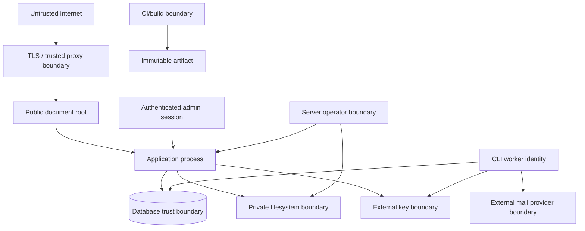

# Threat model

**Status:** Phase 12 `0.4.0` candidate operational controls reviewed.

**Method:** Asset/trust-boundary review with STRIDE-style misuse cases and
privacy-abuse review

**Last reviewed:** 2026-08-26

## Scope and security objectives

This model covers one Emailer Next installation, its administrators, web and
CLI processes, MariaDB, private storage, external master key, mail transport,
public recipient routes, build pipeline, backups, and operator actions. It does
not assume a trusted public network or trusted recipient input.

The primary objectives are:

1. prevent unauthorized campaign or configuration changes;
2. prevent disclosure of credentials, private keys, recipient data, message
   content, tokens, and backups;
3. preserve suppression and campaign-state integrity across races and crashes;
4. prevent the application or tests from sending unexpectedly;
5. keep source, history, logs, private files, and keys outside the public web
   boundary;
6. preserve enough redacted evidence for investigation and recovery.

## Assets

| Asset | Consequence of compromise |
| --- | --- |
| External master key and derived keys | Decryption/forgery of all reversible application secrets |
| SMTP/provider credentials | Unauthorized mail, provider/account abuse |
| Owner/admin credentials, MFA, recovery and sessions | Administrative account takeover |
| Recipient addresses, attributes, consent and RSVP data | Privacy harm, regulatory exposure, targeting |
| Suppression store | Unwanted or unlawful mail if removed/bypassed |
| Templates, campaign snapshots and sender identity | Brand abuse, content tampering, phishing |
| Delivery ledger and queue state | Duplicate sends, missing sends, dishonest progress |
| Public recipient tokens | Unauthorized unsubscribe, tracking correlation, private content exposure |
| Audit/health/backup/release evidence | Detection evasion and unsafe recovery |
| Clean Git history and build artifact | Persistent credential/PII disclosure or supply-chain compromise |

## Actors

- Anonymous internet attacker probing the web server and setup surface.
- Credential-stuffing attacker targeting administrators.
- Malicious or curious recipient altering or forwarding public links.
- Lower-privileged authenticated Operator or Auditor exceeding their role.
- Administrator making an accidental, unsafe configuration change.
- Attacker with a stolen database or backup but not the external master key.
- Dependency/build attacker attempting to alter source or release artifacts.
- Worker/process crash, queue race, storage failure, or ambiguous SMTP outcome.
- Server administrator or root attacker, treated as outside the guaranteed
  protection boundary but still constrained by least privilege where possible.

Administrators, uploaded files, template content, mail-provider responses,
forwarded proxy headers, and restored artifacts are inputs, not automatically
trusted principals.

## Trust boundaries

The web process must not acquire operator/root authority. The database does not
hold the master key. The queue is not a secret store. A provider accepting a
message does not prove inbox delivery.

## Threat and mitigation register

| ID | Threat / abuse case | Required controls | Verification phase |
| --- | --- | --- | --- |
| TM-01 | Anonymous attacker completes or disrupts first-run setup | Fixed filesystem proof; hashed 160-bit challenge; active-state no-replacement lock; bounded same-session retries; expiry/attempt limit; `lstat`; no request-body proof; HTTPS gate; permanent lock | 2–3 |
| TM-02 | Setup proof leaks through log, error, session, or race | Store hash only; generic response; redacted logging; state/proof deletion; session rotation; concurrent verification test | 2 |
| TM-03 | Web server exposes `.git`, `.env`, source, logs, backups, private data, or key | `public/` document root; artifact allowlist; server probes; safe permissions; Doctor sending gate | 1/8/9 |
| TM-04 | Stolen database reveals SMTP secret or TOTP seed | XChaCha20-Poly1305; external key; purpose HKDF; fresh nonce; record-bound AAD; fail closed | 3 |
| TM-05 | Key substitution, permission weakness, or ciphertext swapping | Explicit absolute external path; complete ancestor ownership/mode/link and replacement checks; strict key length/mode/link count; installation/record/type/version in AAD; constant-time failure; transactional rotation | 3 |
| TM-06 | Password/session/account takeover | Argon2id; throttling; optional TOTP with Owner policy; hashed recovery codes; secure server sessions; rotation/revocation; generic recovery | 3–4 |
| TM-07 | Operator exceeds role or removes last Owner | Default-deny route and service authorization; recent auth; generated role matrix; database/application invariant; audit | 4 |
| TM-08 | CSRF or unsafe GET changes state | Unsafe methods for mutations; framework CSRF negative matrix; SameSite cookie; public-token routes isolated | 4/7 |
| TM-09 | Proxy/header spoofing bypasses HTTPS or changes host/base URL | Explicit trusted proxies/hosts; reject arbitrary forwarded headers; canonical URL checks; Doctor finding | 2–4/8 |
| TM-10 | Malicious CSV exhausts memory or injects content | Streaming parser; size/row/field/column limits; encoding/control validation; private random files; formula neutralisation | 5 |
| TM-11 | Template executes script, injects headers, or exfiltrates data | Allowlisted merge language and HTML; context encoding; no PHP/Twig/JS/forms/iframes/SVG; link manifest; synthetic preview | 5 |
| TM-12 | Path traversal, symlink, MIME spoof, or executable upload | Server-selected paths; no symlink following; content MIME detection; raster allowlist; size/dimension limits; no execute permission | 2/5 |
| TM-13 | Race bypasses global suppression | Idempotent durable suppression; check on all entry points and immediately before transport; unavailable store blocks sending | 5–7 |
| TM-14 | Queue replay/crash produces duplicate or dishonest delivery state | Unique ledger row; deterministic Message-ID; transactional transitions; bounded retry; ambiguous state; progress from ledger | 6 |
| TM-15 | HTTP endpoint invokes worker or arbitrary send | Worker and restore are CLI-only; no route; route inventory and negative tests | 4/6/8 |
| TM-16 | Queue/log/exception contains credential, full address, body, or token | Identifier-only messages; central redaction; safe exception mapping; output scans and snapshot tests | 1 onward |
| TM-17 | Tampered/wrong-purpose/forwarded token mutates another action | Random opaque handle plus key-version HMAC over purpose/scope/expiry; constant-time MAC validation; 365-day expiry/key overlap; idempotency; no raw address or disclosure | 7 |
| TM-18 | Click route becomes an open redirect | Target fixed and allowlisted at template publication; token link index only; negative redirect tests | 5/10 |
| TM-19 | Tracking correlates recipients without informed configuration | Independently off by default; opaque IDs; approximate reporting; minimized metadata; retention; no admin cookie | 10–12 |
| TM-20 | Backup leaks private data or key, or restore corrupts suppression | Encryption; restrictive private path; manifest; plaintext key excluded; CLI preflight/staging/rollback; restore drill | 8 |
| TM-21 | Secret/PII enters Git, history, CI log, fixture, or artifact | Clean-room review; placeholder config; current/history scans; output redaction; artifact allowlist; merge/release gate | Every phase |
| TM-22 | Tests or test mode contact live SMTP | Mailpit-only configuration; network denial/allowlist in CI; recipient rewrite; safety property test | 1 onward |
| TM-23 | Dependency or build compromise changes release | Lockfile; audit; minimal packages; static/test gates; SBOM/checksum/signature; immutable allowlisted artifact | 1/8 onward |
| TM-24 | Disk/database/log/provider outage corrupts campaign state | Transactions; bounded queues; circuit breaker; health gates; redacted fallback logging; backup/restore; operator-visible status | 6–8 |
| TM-25 | Configuration Doctor becomes a secret oracle or auto-repair hazard | Redacted evidence; authorized detail; coarse public health; no automatic repair/DNS/account action | 8 |
| TM-26 | Forged, downgraded, incompatible, or interrupted package update executes code or leaves an unsafe mixed release | Pinned signing key; deterministic manifest/digests; minimum-source/schema compatibility; immutable release directory; maintenance lock; verified backup; atomic switch; health gate; tested rollback/restore | 8 onward |

## Privacy abuse cases

- A public URL, log label, metric, filename, or correlation ID must not identify
  a recipient.
- Ordinary operational views mask addresses; full-address access and exports
  receive a separate authorization decision and audit event.
- Open events are approximate and must not be represented as proof that a human
  read a message.
- A forwarded recipient link may allow the holder to exercise its scoped
  action. Phase 7 bounds tokens to 365 days, treats repeats idempotently, and
  documents that bearer/forwarding behavior for operators.
- Suppression outlives ordinary delivery analytics. Retention cannot silently
  re-enable delivery.
- Diagnostics, Doctor exports, screenshots, test snapshots, and incident
  bundles exclude raw recipient data and message bodies by default.

## Phase 1 control status

Phase 1 supplies the first controls for the threats assigned to it:

| Threat | Implemented evidence | Remaining work |
| --- | --- | --- |
| TM-03 | Only `public/index.php` is a web entry point; an allowlisted production-shaped artifact is inspected and probed for forbidden paths | Representative Nginx/Apache profiles and Doctor boundary checks remain Phases 8–9 |
| TM-16 | JSON logging and a central processor redact sensitive keys, exception messages, address-like values, credential assignments, DSN user information, and controls | Identifier-only queue payloads and feature-specific safe exception mapping arrive with their owning phases |
| TM-21 | Placeholder configuration, pinned Gitleaks current/full-history scans, private-key/private-data checks, artifact scanning, and no-value output | Every later phase must retain and extend these gates |
| TM-22 | Test kernel Mailpit allowlist, negative DSN tests, loopback Mailpit integration, and CI internal-network egress denial | Delivery-specific fake-provider tests arrive in Phase 6 |
| TM-23 | Locked dependencies, strict validation/audit, pinned build tools, static/tests, and allowlisted artifact | Manifest/SBOM/checksum/signature tooling remains Phase 8; first release acceptance is Phase 9 |
| TM-25 | Public liveness returns only fixed coarse JSON without a session | Authenticated Doctor is Phase 8 |
| TM-26 | Immutable runtime/writable separation is designed and artifact inputs are allowlisted | Signed package verification and interruption/compatibility rehearsals remain Phases 8–9 |

The scaffold contains no business send command, queue message, worker, or
arbitrary-send HTTP route. The Mailpit integration uses only reserved synthetic
addresses.

## Phase 3 control status

- TM-01 closes the completion half of first-run setup with one lifecycle lock
  shared by every writer/finalization, immediate dual-state open checks,
  irreversible lock publication, post-lock record immutability, and 404 behavior.
- TM-04/TM-05 are implemented for TOTP and future reversible secret records
  with an explicit validated external key, purpose HKDF, record-bound AAD,
  fresh nonces, and authenticated versioned envelopes. The Phase 3 Mailpit
  probe accepts no credential. Root/process-memory compromise remains outside
  the guarantee.
- TM-06 is implemented only for idempotent initial Owner creation with stored-
  hash password verification, Argon2id storage, optional setup-time TOTP with
  pending-material cleanup/single-applicable-set enforcement, and single-use
  recovery-code storage/consumption.
  Login, session, throttling, reset, re-authentication, and administration are
  still Phase 4.
- TM-16/TM-21 tests scan database/runtime outputs and generic exceptions for
  submitted secret absence; aggregate tree/history/artifact gates remain
  mandatory.
- TM-22 mail setup/tests persist exactly the plaintext, unauthenticated Mailpit
  probe and reject TLS/auth/live destinations. No production transport,
  recipient, provider credential, DNS action, or delivery path exists.

## Phase 4 control status

- TM-06 now has individual Argon2id accounts, combined password/TOTP or
  single-use recovery authentication, account/source throttles, generic login
  and recovery errors, HMAC-indexed MariaDB sessions, fixed idle/absolute
  limits, rotation, listing, revocation, and short-lived hashed reset tokens.
- TM-07 is enforced by the exhaustive route registry and application services.
  Administrators cannot promote/remove Owners, and row-locked concurrent
  demote/disable/delete tests prove one active Owner survives.
- TM-08/TM-09 have an all-mutation CSRF/method matrix, purpose-bound five-minute
  re-authentication, host-only Secure/HttpOnly/SameSite-Lax cookies, explicit
  trusted proxies, untrusted-forwarded-header rejection, CSP, HSTS on verified
  HTTPS, no-sniff/frame/referrer/permissions policies, and private no-store
  responses.
- TM-16/TM-21 audit events contain opaque IDs and bounded redacted summaries;
  application validation and database triggers make the store append-only.
  Mail remains local Mailpit only.

## Phase 5 control status

- Recipient data is masked in ordinary views; full reveal/export is
  Administrator-only, recent-authenticated, CSRF-protected, formula-neutralized
  where applicable, and audited without raw addresses.
- CSV upload is private, random-named, size/row/column/field bounded, UTF-8 and
  control validated, inode/integrity checked, database staged, and represented
  in reports only by row number and safe reason. Commit rechecks suppression.
- Suppression insertion and memberships are idempotent under uniqueness
  constraints. No suppression removal or bypass path exists in Phase 5.
- Templates use a maintained strict-allowlist sanitizer, non-evaluating exact
  merge grammar, context-aware escaping, validated HTTPS/mailto links,
  immutable version digests, and synthetic-only preview.
- Uploaded images reject links and unapproved formats, are isolated in private
  temporary storage, decoded with GD, dimension bounded, metadata-stripped by
  re-encoding, and published only under random raster filenames.

Residual Phase 5 risks are authorized administrator disclosure, denial of
service within bounded authenticated import quotas, and local host compromise.
Campaign snapshotting, final pre-send suppression, public tokens, and live
delivery remain later phases and are not claimed here.

## Phase 6–7 control status

- Phase 6 closes the durable-delivery portion of TM-13–TM-16 with immutable
  snapshots, unique ledgers, identifier-only jobs, immediate pre-transport
  suppression, bounded retries, ambiguous terminal state, and redacted errors.
- Phase 7 closes the MVP unsubscribe portion of TM-08, TM-13, TM-16, and TM-17.
  Public routes are cookie-free and separate from admin authentication. Tokens
  contain no address, are version/purpose/scope/expiry authenticated, and have
  bounded key overlap and row retention. Manual and one-click mutations are
  idempotent, rate-limited, generic, and immediately insert global suppression.
- RFC 8058 advertising is disabled unless the Owner records provider DKIM
  coverage. The application constructs the required headers but the external
  provider produces the final signature; deployment verification remains an
  explicit Phase 8 Doctor concern.

Residual risk remains from distributed authentication abuse, database
availability affecting sessions, stolen active browser authority before its
deadline, and root/process-memory compromise. Owner MFA health enforcement is
still owned by the later authenticated Doctor; Phase 4 does not claim a green
production sending state.

## Phase 8 control status

- TM-20 now has authenticated-encrypted streaming backups, separate
  passphrase-encrypted key recovery, corruption/wrong-passphrase rejection,
  pre-restore safety backup, suppression-preserving restore, and post-restore
  quiescence.
- TM-24/TM-25 now have bounded readiness probes and redacted evidence. Critical
  results fail closed at campaign queue, schedule, and scheduler materialisation.
- TM-23/TM-26 now have deterministic metadata, SPDX, checksum, detached
  Ed25519 verification against a pinned external key, unsafe archive rejection,
  compatibility/disk checks, immutable install, update lock, quiescence,
  verified backup, migration, atomic pointer, Doctor, and compatible
  rollback-or-restore behavior.

## Phase 9 control status

- TM-21/TM-23 now include current and reachable-history scans, deterministic
  exact-source packaging, SPDX license evidence, external operator signing-key
  custody, pinned-key handle validation, and independent signature/checksum/file
  verification before immutable clean install.
- TM-11/TM-13 acceptance now includes an explicit campaign approval summary,
  static accessibility checks, and a bounded synthetic audience/load profile.
- The signed `0.1.0-rc.1` to `0.1.0` rehearsal covers compatible update,
  interrupted migration restore, failed-health pointer rollback, incompatible
  schema and inadequate disk without implying a supported client prerelease.

Phase 9 does not claim package publication, production deployment, unattended
backup/update, DNS/provider configuration, live SMTP contact, or any Phase 10
tracking/view behavior.

## Phase 10 control status

- TM-17/TM-18 now cover separate view/open/click purposes, authenticated scope
  and expiry, cookie-free/no-store public handling, and HTTPS redirects selected
  only by an index into the link manifest frozen at template publication and
  campaign approval. A request cannot supply a redirect URL.
- Tracking is independently disabled by default and frozen at approval. When a
  feature is disabled, delivery generates neither its token nor its pixel or
  rewritten link. View-in-browser remains separately purpose-scoped.
- Analytics rows contain only recipient-ledger identity, event kind, bounded
  link index, count, and first/last UTC timestamps. Analytics-token rows omit
  the recipient address. IP, user agent, headers, and raw destinations are not
  stored, logged, or emitted as metrics.
- Replay increments an approximate aggregate and forwarding is intentionally
  bearer behavior attributed to the original campaign recipient; neither is
  represented as proof of human readership. Retention is configurable from 1
  to 365 days and processed in bounded dry-run/apply batches.
- The `0.1.0` to `0.2.0` update is fail-closed and uses verified backup restore
  rather than pointing old code at the forward-only Phase 10 schema.

Phase 10 does not implement RSVP, publish/deploy a package, contact a live mail
provider, or claim exact/person-level analytics.

## Phase 11 control status

- RSVP requires independent installation and draft-campaign opt-in; approval
  freezes enablement, fixed schema, and repeat policy.
- A dedicated authenticated token purpose prevents view, tracking, or
  unsubscribe authority from being reused. Tokens and rows contain no raw
  address, IP, user agent, or request headers. Forwarding transfers only the
  bounded RSVP authority for the original campaign recipient.
- Exact field allowlisting, a 2 KiB request bound, enum/range/length checks,
  database constraints, and serialized unique-row writes limit injection,
  storage abuse, and concurrent repeats.
- Ordinary authorized views expose aggregates only. Private CSV export requires
  Administrator authority, CSRF and recent re-authentication, is audited, uses
  opaque recipient IDs, and neutralizes spreadsheet formulas.
- Separate bounded retention and encrypted backup coverage apply to responses.
  The `0.2.x` to `0.3.0` update uses verified backup restore on failure.

Phase 11 does not publish/deploy the package, contact live SMTP, or implement
Phase 12 Doctor and automation expansion.

## Phase 12 control status

- TM-20 readiness bypass is reduced by explicit marker contracts for
  lightweight, full, and send-gating probes; failures are generic/redacted and
  critical banners persist across sessions.
- TM-24 backup loss/corruption is reduced by off-by-default approved-destination
  policy, safe-root checks, exclusive restrictive copies, byte/hash read-back,
  recency/cadence findings, and bounded deletion that preserves the newest
  verified backup.
- TM-25 unsafe maintenance is reduced by one non-overlap scheduler, due-time
  evidence, bounded dry-run/apply retention, forward-only migration recovery,
  and no HTTP restore/update/deployment path.
- A malicious or compromised mounted filesystem can still deny service or
  delete copies. Operators need independent mount credentials/snapshots and
  restore drills; this adapter does not claim immutable or off-site custody.

Phase 12 does not publish/deploy a package, create a cloud account, contact a
provider, rotate a credential, change DNS, or use live SMTP.

## Residual risks and non-guarantees

The design cannot guarantee protection after full root compromise, a malicious
server administrator reading process memory/key files, compromise of an
administrator endpoint after secrets are unlocked, or compromise of the mail
provider. SMTP acceptance is not inbox delivery, and an ambiguous network
failure can create duplicate risk despite deterministic identifiers.

Rate limiting reduces abuse but cannot guarantee availability during a large
distributed attack. Open tracking is intrinsically approximate and
privacy-sensitive. A holder of a valid forwarded public token has its scoped
authority until expiry or revocation policy says otherwise.

## Review triggers

Review this model before adding a public route, new secret type, new outbound
service, new upload format, provider adapter, data export, backup destination,
authentication mechanism, plugin system, multi-process topology, or schema that
crosses module ownership. Every phase closes or tests its listed controls and
records new residual risks.
