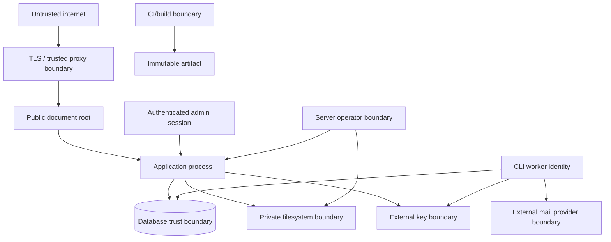

# Threat model

**Status:** Phase 2 setup controls reviewed.

**Method:** Asset/trust-boundary review with STRIDE-style misuse cases and
privacy-abuse review

**Last reviewed:** 2026-08-15

## Scope and security objectives

This model covers one Emailer Next installation, its administrators, web and
CLI processes, MariaDB, private storage, external master key, mail transport,
public recipient routes, build pipeline, backups, and operator actions. It does
not assume a trusted public network or trusted recipient input.

The primary objectives are:

1. prevent unauthorized campaign or configuration changes;
2. prevent disclosure of credentials, private keys, recipient data, message
   content, tokens, and backups;
3. preserve suppression and campaign-state integrity across races and crashes;
4. prevent the application or tests from sending unexpectedly;
5. keep source, history, logs, private files, and keys outside the public web
   boundary;
6. preserve enough redacted evidence for investigation and recovery.

## Assets

| Asset | Consequence of compromise |
| --- | --- |
| External master key and derived keys | Decryption/forgery of all reversible application secrets |
| SMTP/provider credentials | Unauthorized mail, provider/account abuse |
| Owner/admin credentials, MFA, recovery and sessions | Administrative account takeover |
| Recipient addresses, attributes, consent and RSVP data | Privacy harm, regulatory exposure, targeting |
| Suppression store | Unwanted or unlawful mail if removed/bypassed |
| Templates, campaign snapshots and sender identity | Brand abuse, content tampering, phishing |
| Delivery ledger and queue state | Duplicate sends, missing sends, dishonest progress |
| Public recipient tokens | Unauthorized unsubscribe, tracking correlation, private content exposure |
| Audit/health/backup/release evidence | Detection evasion and unsafe recovery |
| Clean Git history and build artifact | Persistent credential/PII disclosure or supply-chain compromise |

## Actors

- Anonymous internet attacker probing the web server and setup surface.
- Credential-stuffing attacker targeting administrators.
- Malicious or curious recipient altering or forwarding public links.
- Lower-privileged authenticated Operator or Auditor exceeding their role.
- Administrator making an accidental, unsafe configuration change.
- Attacker with a stolen database or backup but not the external master key.
- Dependency/build attacker attempting to alter source or release artifacts.
- Worker/process crash, queue race, storage failure, or ambiguous SMTP outcome.
- Server administrator or root attacker, treated as outside the guaranteed
  protection boundary but still constrained by least privilege where possible.

Administrators, uploaded files, template content, mail-provider responses,
forwarded proxy headers, and restored artifacts are inputs, not automatically
trusted principals.

## Trust boundaries

The web process must not acquire operator/root authority. The database does not
hold the master key. The queue is not a secret store. A provider accepting a
message does not prove inbox delivery.

## Threat and mitigation register

| ID | Threat / abuse case | Required controls | Verification phase |
| --- | --- | --- | --- |
| TM-01 | Anonymous attacker completes first-run setup | Fixed filesystem proof; hashed 160-bit challenge; expiry/attempt limit; `lstat`; no request-body proof; HTTPS gate; permanent lock | 2–3 |
| TM-02 | Setup proof leaks through log, error, session, or race | Store hash only; generic response; redacted logging; state/proof deletion; session rotation; concurrent verification test | 2 |
| TM-03 | Web server exposes `.git`, `.env`, source, logs, backups, private data, or key | `public/` document root; artifact allowlist; server probes; safe permissions; Doctor sending gate | 1/8/9 |
| TM-04 | Stolen database reveals SMTP secret or TOTP seed | XChaCha20-Poly1305; external key; purpose HKDF; fresh nonce; record-bound AAD; fail closed | 3 |
| TM-05 | Key substitution, permission weakness, or ciphertext swapping | Strict key length/mode/parent checks; installation/record/type/version in AAD; constant-time failure; transactional rotation | 3 |
| TM-06 | Password/session/account takeover | Argon2id; throttling; optional TOTP with Owner policy; hashed recovery codes; secure server sessions; rotation/revocation; generic recovery | 3–4 |
| TM-07 | Operator exceeds role or removes last Owner | Default-deny route and service authorization; recent auth; generated role matrix; database/application invariant; audit | 4 |
| TM-08 | CSRF or unsafe GET changes state | Unsafe methods for mutations; framework CSRF negative matrix; SameSite cookie; public-token routes isolated | 4/7 |
| TM-09 | Proxy/header spoofing bypasses HTTPS or changes host/base URL | Explicit trusted proxies/hosts; reject arbitrary forwarded headers; canonical URL checks; Doctor finding | 2–4/8 |
| TM-10 | Malicious CSV exhausts memory or injects content | Streaming parser; size/row/field/column limits; encoding/control validation; private random files; formula neutralisation | 5 |
| TM-11 | Template executes script, injects headers, or exfiltrates data | Allowlisted merge language and HTML; context encoding; no PHP/Twig/JS/forms/iframes/SVG; link manifest; synthetic preview | 5 |
| TM-12 | Path traversal, symlink, MIME spoof, or executable upload | Server-selected paths; no symlink following; content MIME detection; raster allowlist; size/dimension limits; no execute permission | 2/5 |
| TM-13 | Race bypasses global suppression | Idempotent durable suppression; check on all entry points and immediately before transport; unavailable store blocks sending | 5–7 |
| TM-14 | Queue replay/crash produces duplicate or dishonest delivery state | Unique ledger row; deterministic Message-ID; transactional transitions; bounded retry; ambiguous state; progress from ledger | 6 |
| TM-15 | HTTP endpoint invokes worker or arbitrary send | Worker and restore are CLI-only; no route; route inventory and negative tests | 4/6/8 |
| TM-16 | Queue/log/exception contains credential, full address, body, or token | Identifier-only messages; central redaction; safe exception mapping; output scans and snapshot tests | 1/3–9 |
| TM-17 | Tampered/wrong-purpose/forwarded token mutates another action | Opaque purpose/scope/key-version token; constant-time validation; expiry/repeat policy; idempotency; no raw address | 7 |
| TM-18 | Click route becomes an open redirect | Target fixed and allowlisted at template publication; token link index only; negative redirect tests | 5/7 |
| TM-19 | Tracking correlates recipients without informed configuration | Independently off by default; opaque IDs; approximate reporting; minimized metadata; retention; no admin cookie | 7–8 |
| TM-20 | Backup leaks private data or key, or restore corrupts suppression | Encryption; restrictive private path; manifest; plaintext key excluded; CLI preflight/staging/rollback; restore drill | 8 |
| TM-21 | Secret/PII enters Git, history, CI log, fixture, or artifact | Clean-room review; placeholder config; current/history scans; output redaction; artifact allowlist; merge/release gate | Every phase |
| TM-22 | Tests or test mode contact live SMTP | Mailpit-only configuration; network denial/allowlist in CI; recipient rewrite; safety property test | 1 onward |
| TM-23 | Dependency or build compromise changes release | Lockfile; audit; minimal packages; static/test gates; SBOM/checksum; immutable allowlisted artifact | 1/9 |
| TM-24 | Disk/database/log/provider outage corrupts campaign state | Transactions; bounded queues; circuit breaker; health gates; redacted fallback logging; backup/restore; operator-visible status | 6–8 |
| TM-25 | Configuration Doctor becomes a secret oracle or auto-repair hazard | Redacted evidence; authorized detail; coarse public health; no automatic repair/DNS/account action | 8 |

## Privacy abuse cases

- A public URL, log label, metric, filename, or correlation ID must not identify
  a recipient.
- Ordinary operational views mask addresses; full-address access and exports
  receive a separate authorization decision and audit event.
- Open events are approximate and must not be represented as proof that a human
  read a message.
- A forwarded recipient link may allow the holder to exercise its scoped
  action. The exact expiry/repeat policy is an open Phase 7 decision and must be
  explained to operators.
- Suppression outlives ordinary delivery analytics. Retention cannot silently
  re-enable delivery.
- Diagnostics, Doctor exports, screenshots, test snapshots, and incident
  bundles exclude raw recipient data and message bodies by default.

## Phase 1 control status

Phase 1 supplies the first controls for the threats assigned to it:

| Threat | Implemented evidence | Remaining work |
| --- | --- | --- |
| TM-03 | Only `public/index.php` is a web entry point; an allowlisted production-shaped artifact is inspected and probed for forbidden paths | Representative Nginx/Apache profiles and Doctor boundary checks remain Phases 8–9 |
| TM-16 | JSON logging and a central processor redact sensitive keys, exception messages, address-like values, credential assignments, DSN user information, and controls | Identifier-only queue payloads and feature-specific safe exception mapping arrive with their owning phases |
| TM-21 | Placeholder configuration, pinned Gitleaks current/full-history scans, private-key/private-data checks, artifact scanning, and no-value output | Every later phase must retain and extend these gates |
| TM-22 | Test kernel Mailpit allowlist, negative DSN tests, loopback Mailpit integration, and CI internal-network egress denial | Delivery-specific fake-provider tests arrive in Phase 6 |
| TM-23 | Locked dependencies, strict validation/audit, pinned build tools, static/tests, and allowlisted artifact | SBOM/checksum and release acceptance remain Phase 9 |
| TM-25 | Public liveness returns only fixed coarse JSON without a session | Authenticated Doctor is Phase 8 |

The scaffold contains no business send command, queue message, worker, or
arbitrary-send HTTP route. The Mailpit integration uses only reserved synthetic
addresses.

## Residual risks and non-guarantees

The design cannot guarantee protection after full root compromise, a malicious
server administrator reading process memory/key files, compromise of an
administrator endpoint after secrets are unlocked, or compromise of the mail
provider. SMTP acceptance is not inbox delivery, and an ambiguous network
failure can create duplicate risk despite deterministic identifiers.

Rate limiting reduces abuse but cannot guarantee availability during a large
distributed attack. Open tracking is intrinsically approximate and
privacy-sensitive. A holder of a valid forwarded public token has its scoped
authority until expiry or revocation policy says otherwise.

## Review triggers

Review this model before adding a public route, new secret type, new outbound
service, new upload format, provider adapter, data export, backup destination,
authentication mechanism, plugin system, multi-process topology, or schema that
crosses module ownership. Every phase closes or tests its listed controls and
records new residual risks.
